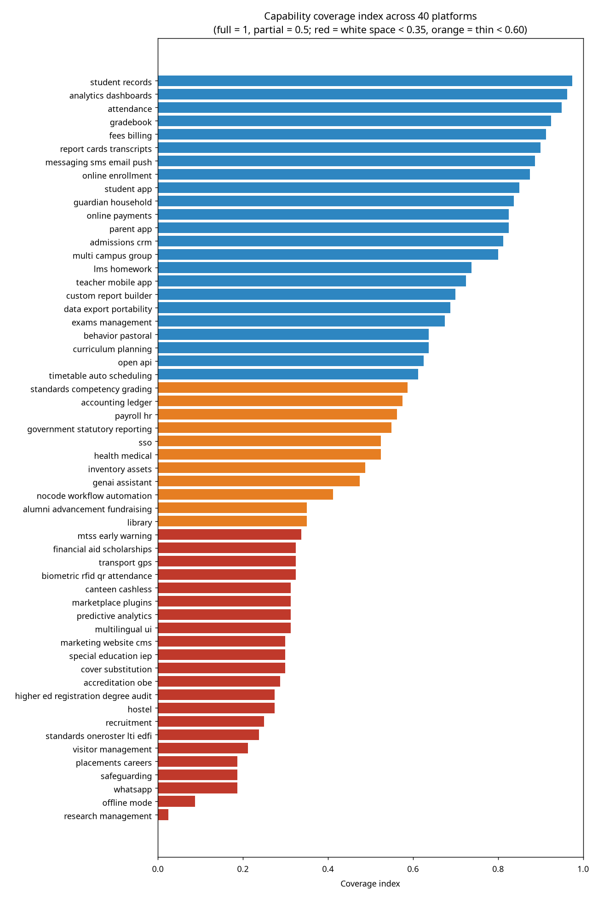
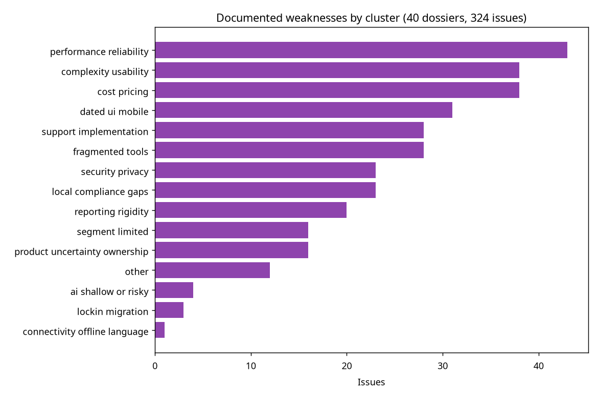
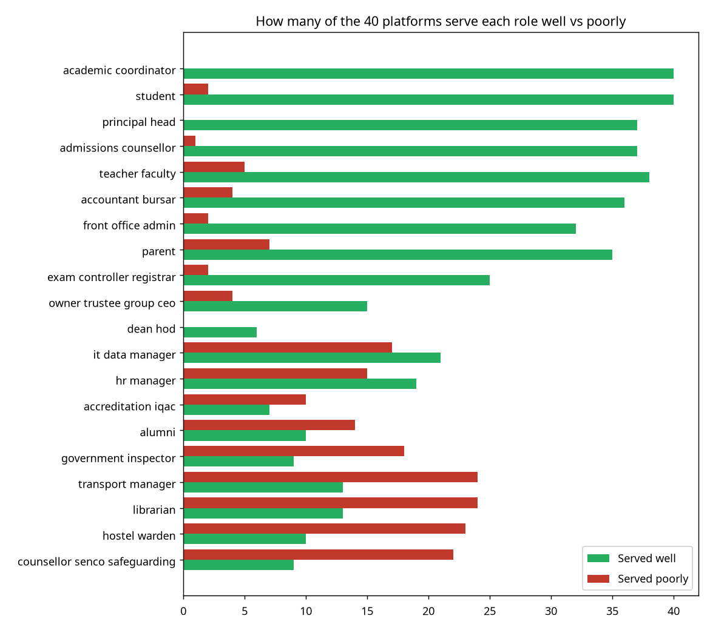

# Acadyne: The Complete Platform Blueprint (v2)

**One open platform to run a nursery, a school, a college, a university or a group of all four, built from the evidence on 40 competitor platforms.**

> **Status:** This is a blueprint only. No development has started.
>
> **Supersedes:** "OpenCampus One" (blueprint v1). Everything in v1 that still holds is carried forward. This version adds the role-by-role analysis, a quantitative competitor coverage matrix, the white-space features, the design system and an MVP prioritisation.
>
> **Evidence base:**
> - every file in the repository https://github.com/S4syedRauf/school-management-platforms-research;
> - a structured re-extraction of all 40 platform dossiers, covering 56 capabilities and 324 documented weaknesses. It is stored in `10-deep-blueprint/analysis/`.
>
> **Link rule:** every reference is a full, visible URL.

---

## How to read this document

| If you are... | Read first |
|---|---|
| The founder or investor deciding whether to build | Sections 1, 2, 4, 13 and 15 |
| A product manager deciding what to build first | Sections 4, 5, 6, 7 and 12 |
| A designer | Sections 5, 9 and 10 |
| An engineer or architect | Sections 10, 11 and 12 |
| An institution leader evaluating the vision | Sections 5, 6 and 7 |

## Contents

1. What the research repository is and what it proves
2. How this blueprint was produced (method and evidence)
3. The platform name: Acadyne
4. The twelve root problems and exactly how Acadyne fills each gap
5. The people who run institutions: 26 roles, their goals, pains, what competitors offer today and what Acadyne offers
6. The complete feature catalogue, by module, with who it helps and how
7. Beyond the ERP: 16 institution-level features no competitor combines
8. Responsible AI: one copilot, many roles, hard guardrails
9. Product and UX design: how the platform should look, feel and behave
10. Technical architecture: how it should be built
11. The switching engine: how institutions move to Acadyne
12. What to build first: scoring, MVP and release trains
13. Business model, pricing and go-to-market
14. Battlecards: how Acadyne beats each major competitor
15. Metrics, risks and the honest path to number one
16. References

---

## 1. What the Research Repository Is and What It Proves

### 1.1 In one paragraph

The repository https://github.com/S4syedRauf/school-management-platforms-research is a complete competitive-intelligence study of education management software. It ranks the 20 most important platforms worldwide and the 10 most important in India, and evaluates 10 further candidates. Each platform has its own dossier: features, pricing, founding year, platform type, integrations, security, strengths, weaknesses and full reference links. The repository also contains:

- a reverse-engineering-style teardown of the publicly observable backends of the top systems (PowerSchool, Infinite Campus and Ellucian);
- supporting research on standards, privacy law, Indian digital public infrastructure, open-source technology and market pain points;
- a first product blueprint (v1);
- the scoring data, the scripts and a reusable research skill.

The purpose of the whole body of work is to answer one question: **what platform could be built that institutions would prefer to every one of these?**

### 1.2 Folder-by-folder map

| Folder | What it contains | Why it matters for the platform |
|---|---|---|
| `01-report/` | The 152,600-word master report and an executive summary with ranking tables, the classification matrix (web, cloud, desktop, mobile), pricing and corrections to the original guide | The single source of truth for every ranking and claim |
| `02-platform-profiles/01-worldwide-top-20/` | 20 dossiers: PowerSchool (8.8), Ellucian (8.4), Arbor (8.2), Alma (8.1), FACTS (7.9), Workday Student (7.7), Synergy (7.7), Veracross (7.6), Focus (7.6), Blackbaud (7.5), Bromcom (7.5), Jenzabar (7.5), Infinite Campus (7.3), Skyward (7.3), Compass (7.3), Classter (7.3), openSIS (7.2), iSAMS (7.0), Anthology (7.0), SIMS (6.9) | What "best in the world" looks like today, and where it fails |
| `02-platform-profiles/02-india-top-10/` | 10 dossiers: MasterSoft (7.9), Camu (7.8), Fedena (7.6), NextOS (7.6), Academia/Serosoft (7.4), Skolaro (7.3), Vidyalaya (7.2), MyClassboard (7.0), Entab (7.0), LEAD School (6.5) | The Indian beachhead market and its local feature expectations |
| `02-platform-profiles/03-also-evaluated/` | 10 dossiers: Aeries, Gradelink, ManageBac, Oracle Campus Solutions, Gibbon, Teachmint, Edunext, OpenEduCat, Toddle, MyClassCampus | Specialists (IB, curriculum, open source) that set the bar in niches |
| `03-backend-teardown/` | Public-evidence architecture teardown of PowerSchool, Infinite Campus and Ellucian Banner/Colleague/Ethos, with 12 architecture lessons | How to build the backend better than the market leaders |
| `04-blueprint/` | Blueprint v1, "OpenCampus One" | The starting point that this document deepens |
| `05-supporting-research/` | A: standards, privacy, accessibility, security and India DPI (UDISE+, APAAR, ABC, DigiLocker, PARAKH, NAAC, NBA, NIRF, AISHE, DPDP). B: open-source stack, free tiers and deployment. C: market size, consolidation, security incidents, UK market share, AI adoption, pain points and pricing benchmarks | The non-negotiable compliance list, the cost-free technical path and the buyer evidence |
| `06-rankings-and-data/` | Scores, ranking JSON and Markdown, and `platform_key_fields.json` | The quantitative backbone of the ranking |
| `07-methodology-and-skill/` | The research skill, scoring rubric (features 30%, adoption 30%, advanced features 20%, UX/mobile 10%, interoperability 10%), profile template and blueprint framework | Repeatable method, so the analysis can be refreshed every year |
| `08-scripts/` | Report assembly and results-building scripts | Reproducibility |
| `09-source-inputs/` | The user's original guide | The original hypothesis, corrected where the evidence disagreed |
| `10-deep-blueprint/` (new) | This document, the 40 structured extractions, the coverage matrix and charts | The decision layer: what to build, for whom, in what order |

### 1.3 The seven things the research proves

1. **Breadth is commoditised; experience is not.** Student records (97% coverage), dashboards (96%), attendance (95%), gradebooks (93%) and fees (91%) are present almost everywhere. Yet the 2025 survey by The Key of 961 UK MIS users scored average satisfaction at only 6.6/10. Only 47% found their system intuitive for new users, and 54% were satisfied with support. Winning on features alone is impossible. Winning on how the features feel to use is wide open.
2. **Every vendor has the same top complaints.** Across 40 dossiers, cost and pricing complaints appear for 37 platforms. Performance and reliability complaints appear for 32, complexity for 30, dated UI or mobile for 26, fragmented tools for 26 and support or implementation for 24.
3. **Whole roles are abandoned.** Safeguarding and SEN leads are served poorly by 22 of 40 platforms, hostel wardens by 23, librarians and transport managers by 24 each, and government or inspection users by 18. These people still do their jobs, but on paper, WhatsApp groups and spreadsheets.
4. **The IT or data manager is the most-hurt person in the market.** They are the affected role in 97 of 324 documented weaknesses: integrations, migrations, reporting, security and upgrades. The owner or trustee is next with 54, then teachers (36), parents (27) and principals (27).
5. **Real white space exists.** No platform documents a full offline mode (0 full, 7 partial). Only one documents full safeguarding case management. Only two document full certified standards support (OneRoster, LTI, Ed-Fi). Only five document full WhatsApp integration, and none documents research management or a full marketing website/CMS.
6. **K-12 and higher education are still split.** Ellucian, Workday, Jenzabar, Anthology and Oracle are higher-education only. PowerSchool, Arbor, Alma, FACTS and Bromcom are K-12 only. Only a few Indian systems (MasterSoft, Camu, Academia, OpenEduCat) straddle both, and they are weaker on interoperability and assurance.
7. **Trust is now a buying criterion.** The PowerSchool (2024–2025), Blackbaud (2020), Illuminate (2021, FTC action 2025) and Frontline (2026) incidents showed that the support plane and credentials of a vendor can expose millions of records. India's DPDP Rules 2025 add verifiable parental consent and breach duties, with child-specific rules commencing around May 2027.

**Conclusion:** the winning platform is not "another ERP with more modules". It is a **trustworthy operating system for an institution**. It makes everyday work faster for every role, including the forgotten ones, and works on cheap phones and bad networks. It proves its security and lets institutions leave whenever they like.

---

## 2. How This Blueprint Was Produced

### 2.1 Inputs read

- **All 40 platform dossiers in `02-platform-profiles/`.** About 948 KB of text: feature inventories, pricing, integrations, security, strengths, weaknesses, milestones and references.
- **The backend teardown.** All of `03-backend-teardown/`, including its 12 architecture lessons.
- **The three supporting research appendices** (A, B, C).
- **Blueprint v1.**
- **The ranking data and scoring rubric.**
- **The user's original guide** in `09-source-inputs/`.

### 2.2 Structured re-extraction

Each of the 40 dossiers was processed with the same strict JSON schema, which captured:

- **Coverage of 56 normalised capabilities,** each graded full, partial, or none/not documented.
- **Up to 10 distinctive features,** each with why it matters.
- **Up to 10 weaknesses,** each mapped to one of 15 pain clusters and to the role most affected.
- **The roles served well and poorly,** using 20 standard roles.
- **AI features,** the pricing model and the single biggest strategic gap.

The 40 extractions, the CSV coverage matrix and the scripts are in `10-deep-blueprint/analysis/`. Anyone can re-run them.

**Caveat:** "none" means "not documented in public evidence", not proof of absence. The matrix shows where the market's public story is thin, and that is exactly where a buyer's confidence is low.

### 2.3 The reasoning lenses applied

Every feature in this blueprint passed through five lenses:

1. **Evidence lens.** Is there documented pain, a documented gap, or a regulatory requirement?
2. **Role lens.** Which real person does it help? How often do they do this job? What happens if it fails?
3. **Competitor lens.** Who does it best today? What exactly is still wrong with their version?
4. **Feasibility lens.** Can an open-source team build it with a largely free stack, and is it safe?
5. **Moat lens.** Does it compound, through data network effects, switching ease, community or trust, or is it easily copied?

### 2.4 The evidence in three charts



*Figure 1. Capability coverage across the 40 platforms (full = 1, partial = 0.5). Red bars are white space (index below 0.35). Orange bars are thin coverage (below 0.60). Blue bars are table stakes.*



*Figure 2. The 324 documented weaknesses grouped into pain clusters.*



*Figure 3. For each role, how many of the 40 platforms serve it well and how many serve it poorly.*

### 2.5 Coverage tiers derived from the matrix

| Tier | Capabilities (coverage index) | What it means for Acadyne |
|---|---|---|
| **White space** (below 0.35) | Research management (0.03), offline mode (0.09), WhatsApp (0.19), safeguarding (0.19), placements and careers (0.19), visitor management (0.21), certified standards OneRoster/LTI/Ed-Fi (0.24), recruitment (0.25), hostel (0.28), higher-education registration and degree audit (0.28), accreditation/OBE (0.29), cover and substitution (0.30), special education and IEP (0.30), marketing website/CMS (0.30), multilingual UI (0.31), predictive analytics (0.31), plug-in marketplace (0.31), canteen and cashless (0.31), biometric/RFID/QR attendance (0.33), transport GPS (0.33), financial aid and scholarships (0.33), MTSS and early warning (0.34) | This is where Acadyne wins attention and switching decisions. Each is built as a first-class module, not a bolt-on |
| **Thin** (0.35–0.60) | Library (0.35), alumni and fundraising (0.35), no-code workflow (0.41), generative AI assistant (0.47), inventory and assets (0.49), health (0.53), SSO (0.53), statutory reporting (0.55), payroll and HR (0.56), accounting ledger (0.57), competency grading (0.59) | Acadyne must be clearly better here, because most competitors offer partial or add-on versions |
| **Table stakes** (above 0.60) | Timetable, API, curriculum planning, behaviour, exams, data export, report builder, teacher app, LMS, multi-campus, admissions, parent app, payments, households, student app, enrolment, messaging, report cards, fees, gradebook, attendance, dashboards, student records | These must be present from the first release and executed with better UX, speed and reliability. Parity is required, and delight is the differentiator |

---

## 3. The Platform Name: Acadyne

### 3.1 The recommendation

**Acadyne** (pronounced "AK-a-dyne"): *the open operating system for every institution, from nursery to PhD.*

**Tagline:** *Run your whole institution. Own your data.*

### 3.2 Why this name

- **Meaning.** "Acad-" stands for academy, academic and academia: it covers schools, colleges and universities equally, which no "school-" or "campus-" name does. "-dyne" is the unit of force, so the name reads as *the force that makes an institution run*.
- **Global and neutral.** It is easy to pronounce in English, Hindi, Arabic, Spanish and Swahili. It is not tied to one country, so it travels from India to the UK, the Gulf, Africa and the US.
- **Short and ownable.** Seven letters, two syllables, suitable for an app icon and a domain.
- **Survived screening.** Web searches on 27 November 2026 found no education software product named Acadyne. Eleven other candidates were rejected because they already had education-software or school-product conflicts (table below).

### 3.3 Names screened and rejected

| Candidate | Conflict found (27 Nov 2026) |
|---|---|
| OpenCampus One (v1 working name) | "OpenCampus" is used by existing education organisations and an Instagram-promoted school portal ("Opencompas") |
| Ekam / EkamCampus | EkamCampus (https://ekamcampus.com/) is an all-in-one admissions/attendance/finance product; Ekam OS also exists |
| Sangam | School Sangam by G Systems (https://onlinegsystems.com/school-sangam) is an Indian school management product |
| Taksha | Takshas (https://takshas.com/) and Thaksha (https://www.thaksha.in/) are education LMS products |
| Nalanda | Many Nalanda-named school ERP portals and ERP resellers |
| Ekatva | Ekatva schools and Ekatvam E-Learning app |
| Akhila / Akila | Akila school app on Google Play |
| Vidyara | Vidyara (https://vidyara.tech/) is a school management platform |
| Shaala OS | ShaalaOS concept project and Shala-Connect product |
| CampusSutra | Campus Sutras and Campusutra education brands |
| Eduloom | EduLoom Pro college management system and EduLoom Education |

**Before launch:** run formal trademark searches in India (IP India, classes 9, 41 and 42), the UK (UKIPO), the EU (EUIPO) and the US (USPTO). Also check domain availability (acadyne.org for the foundation, acadyne.app or acadyne.io for the hosted service). Backup names in the same style, which need the same checks: **Academe One**, **Kampusa**, **Vidyanta**.

### 3.4 Brand architecture

One brand with clearly named parts, so every buyer and user knows what they are getting:

| Name | What it is | Who uses it |
|---|---|---|
| **Acadyne Core** | The open-source (AGPL-3.0) platform: data model, modules, API, security | Everyone; self-hosters; developers |
| **Acadyne Cloud** | The hosted service run by the foundation and certified partners, with a public price card | Institutions that want no IT burden |
| **Acadyne Staff** | One mobile and web app for every staff role, with offline mode | Teachers, office staff, wardens, drivers, librarians, counsellors |
| **Acadyne Family** | One app for parents and students covering every child at every campus | Parents, guardians, students |
| **Acadyne Command** | Leadership and group console: KPIs, alerts, compliance calendar, forecasting | Owners, trustees, principals, deans, group CEOs |
| **Ask Acadyne** | The permission-aware AI copilot, with citations and human approval | Every role, with role-specific skills |
| **Acadyne Switch** | Migration engine: importers, Shadow Switch parallel run, exit guarantee | IT and data managers, implementation partners |
| **Acadyne Trust Center** | In-product security, privacy, consent and audit evidence | Data protection officers, IT, inspectors, parents |
| **Acadyne Packs** | Segment and country packs: Early Years, K-12, International, Higher-Ed, Coaching, Vocational, Group, Government, India, UK, US, GCC, Africa | Configured per institution |
| **Acadyne Marketplace** | Signed, sandboxed plug-ins and connectors | Developers, vendors, institutions |

## 4. The Twelve Root Problems and Exactly How Acadyne Fills Each Gap

Blueprint v1 named twelve gap codes (C1–C12). The structured re-extraction regroups them into twelve **root problems** as institutions experience them, each with:

- the evidence behind it;
- the people who suffer from it;
- why incumbents struggle to fix it;
- the exact Acadyne fix;
- the metric that proves the fix works.

Section numbers in brackets (for example §6.3) point to the full feature descriptions.

### Summary table

| # | Root problem (in the user's words) | Evidence from the 40 dossiers | Most-hurt roles | Acadyne's core answer |
|---|---|---|---|---|
| P1 | "It is too hard to learn and use" | 38 complexity issues across 30 platforms; 47% intuitive (The Key 2025) | Teachers, office staff, new staff | Role-based Today screens, command bar, guided wizards, zero-training target |
| P2 | "It is slow and breaks exactly when we need it" | 43 performance or reliability issues across 32 platforms (the largest cluster) | Teachers at the bell, exam cells at results time, parents at fee deadlines | Performance budgets, offline-first, deadline-season load testing, a public status page |
| P3 | "It costs too much and the bill keeps growing" | 38 cost issues across 37 of 40 platforms; quote-only pricing at most enterprise vendors | Owners, bursars, IT | Free open core, published price card, all modules included, total-cost calculator |
| P4 | "Parents and teachers hate the app" | 31 dated UI or mobile issues across 26 platforms; Arbor parent app 1.9/5, PowerSchool Mobile 2.5/5 | Parents, students, teachers | One Family app and one Staff app, native-quality offline PWA plus Expo, a 4.6-star target |
| P5 | "We juggle ten systems that don't talk" | 28 fragmentation issues across 26 platforms, plus 16 segment-limited issues | Office, bursar, IT, principal | One record and one login across every module, from nursery to alumni; open standards for everything else |
| P6 | "Switching in or out is a nightmare, and support is slow" | 28 support or implementation issues across 24 platforms; paid exit data copies (Bromcom); 3–7 month implementations | IT, owners | Acadyne Switch: importers, Shadow Switch parallel run, free one-click exit, a partner network |
| P7 | "We can't get answers from our own data" | 20 reporting-rigidity issues across 20 platforms; predictive analytics coverage only 0.31 | Principals, owners, coordinators, inspectors | Semantic layer, report builder, Ask Acadyne with receipts, explainable early warning |
| P8 | "We can't be sure children's data is safe" | 23 security or privacy issues across 21 platforms; PowerSchool, Blackbaud, Illuminate and Frontline incidents | Owners, IT, data protection officers, parents | Trust Center, row-level isolation, just-in-time support access, consent ledger, published penetration tests |
| P9 | "It doesn't fit our country, language or internet" | 23 local-compliance issues across 19 platforms; offline 0.09, multilingual 0.31, WhatsApp 0.19 | Indian and emerging-market schools, rural teachers, parents | Country packs (India first), offline mode, 22 Indian languages, WhatsApp/SMS/IVR channel waterfall |
| P10 | "It ignores whole parts of our institution" | Safeguarding and SEN poorly served by 22 platforms, hostel by 23, library and transport by 24 each, government by 18; research management 0.03 | Counsellors, wardens, librarians, transport, IQAC, placement, research offices | First-class modules for every forgotten role, all sharing the same record |
| P11 | "AI is either missing or scary" | Generative AI assistant coverage 0.47; AI claims often lack model or governance documentation (Entab, Academia, NextOS); only 45% of US principals report AI policies (RAND 2025) | Everyone; data protection officers | Ask Acadyne: permission-aware, cited, human-approved, local-model option, an AI policy kit |
| P12 | "We don't know if our vendor will still be here" | 16 product-uncertainty issues across 14 platforms: SIMS 7 to Next Gen transition, Teachmint discontinuing admissions and fees, MyClassCampus site redirect, Blackbaud ON API end of life 2027, the Ellucian–Anthology consolidation | Owners, IT | Open source under a foundation, long-term-support releases, open data formats: the institution can never be orphaned |

### P1. "It is too hard to learn and use"

**Evidence.** Complexity and usability appear 38 times across 30 platforms. Reviews of PowerSchool cite a steep learning curve, confusing navigation and too many screens. Reviews of Ellucian cite dated, inconsistent interfaces and multi-step workflows. For Alma, reviewers find standards grading time-consuming. Arbor restricts how far schools can customise permission sets. The Key's 2025 survey found only 47% of users rated their MIS intuitive for new users.

**Who suffers.** Most of all, new and part-time staff: a substitute teacher, a new admissions clerk, a visiting examiner. The cost multiplies with staff turnover, which in Indian private schools is often high every year.

**Why incumbents struggle.** Their products grew by accretion over 20 to 40 years: PowerSchool from 1997, Banner from the 1980s, SIMS from the 1980s. Every customer's customisations constrain their redesign, so they add new screens instead of removing old ones.

**Acadyne fix.**
- **Today screen per role** (§9.3): 80% of daily tasks need no menu at all.
- **Command bar** (Ctrl/Cmd+K) with natural language: "mark 7B absent", "Aarav fee", "book cover for Mrs Rao period 3".
- **Guided wizards with preview and undo** for rare but critical jobs: year-end rollover, promotion, timetable, census, results publication.
- **Familiarity presets** that mirror PowerSchool, SIMS, Arbor, Fedena and Entab menu names (§11).
- **Sandbox twin** of the institution for safe practice, and **60-second in-context videos**.
- **Design standard:** any daily task in three taps or fewer; any new teacher productive in under 30 minutes.

**Proof metric.** Time-to-first-attendance for a brand-new teacher under 10 minutes without training, and a "new-user intuitive" score of at least 80% in our own repeat of The Key's survey question.

### P2. "It is slow and breaks exactly when we need it"

**Evidence.** This is the largest cluster: 43 issues across 32 platforms.
- PowerSchool's Android app shows crashes, stale grades and notification failures.
- Ellucian's SaaS migration brought release defects and reduced control over upgrade timing.
- Arbor has Trustpilot complaints of slow performance and errors.
- Synergy's new gradebook has glitches.
- MyClassboard has reliability complaints about its mobile app.

Failures cluster around deadlines: the 8:30 a.m. register, report-card week, fee due dates, admissions windows and result publication.

**Who suffers.** Teachers at the bell, the exam cell at results time, parents on fee due dates, and the IT manager who takes the blame.

**Why incumbents struggle.** Per-customer instance sprawl (Infinite Campus runs Windows, SQL Server and Tomcat instances per customer), legacy desktop clients next to new web layers (SIMS 7 alongside Next Gen, Jenzabar desktop functions missing from J1 Web), and heavy pages.

**Acadyne fix.**
- **Performance budgets enforced in CI:** first screen under 200 KB, interaction under 100 ms on a 2 GB Android phone, and p95 API latency under 300 ms.
- **Offline-first writes** for attendance, marks and notes, so a slow network never blocks a teacher (§6.3 and §10).
- **Deadline-season engineering:** before every result and fee peak, a synthetic load test at three times the previous peak, with auto-scaling read replicas and queue-based report generation ("your report cards are being generated; we'll notify you").
- **Release discipline:** no feature releases in a tenant's declared exam or results week ("freeze windows"), a staged rollout of 1%, 10% and then 100%, and instant rollback.
- **Public status page** with per-region uptime history and incident write-ups.

**Proof metric.** 99.9% monthly availability on hosted plans, zero missed registers due to platform outage, and p95 latency published monthly.

### P3. "It costs too much and the bill keeps growing"

**Evidence.**
- Cost appears for 37 of 40 platforms, the most widespread complaint of all.
- PowerSchool, Ellucian, Workday, Infinite Campus, Skyward, Blackbaud and Jenzabar are quote-only.
- Reviewers report extra training and plug-in costs (PowerSchool) and paid two-factor authentication (Veracross).
- SIMS rises of at least 25% were anticipated from 2025/26 (Somerset Schools Forum).
- Bromcom charges for additional academic years and extra exit copies.
- Indian list prices are low (₹5,000–₹12,500 per year for small schools), but SMS, WhatsApp, apps and modules are add-ons.

**Who suffers.** Owners and trustees (budget), bursars (unpredictable costs) and small schools priced out of modern software.

**Acadyne fix.**
- **Free forever when self-hosted.** All modules are in the AGPL core, with no "enterprise edition" holding back features.
- **Published hosted price card per student per year** (§13), with every module included.
- **Transparent pass-through for messaging, payment and AI costs,** shown before sending ("this broadcast will cost ₹142 by SMS; ₹0 by app push; send via waterfall?").
- **Total-cost-of-ownership calculator** in the sales site and inside the product: licence, hosting, SMS, payments, staff time saved.
- **Price-rise cap written into hosted terms:** no more than inflation plus 3% per year.
- **Free exit at any time** (P6).

**Proof metric.** Median institution saves at least 30% of total cost versus the system it replaced, published annually from opt-in customer data.

### P4. "Parents and teachers hate the app"

**Evidence.**
- Arbor's parent app scored 1.9/5 when checked, with student-app complaints about homework submission.
- PowerSchool Mobile scored 2.5/5 on Play.
- Skyward's mobile ratings are "notably weak" and Compass has Android usability weaknesses.
- Aeries shows weak mobile usability.
- The Workday mobile app does less than the web, and Student Hubs are browser-only.
- Veracross depends on a third-party (Digistorm) app.

Parents also juggle several apps: one for the SIS, one for payments, one for transport and one for messages.

**Who suffers.** Parents (most numerous user group), students and teachers on phones.

**Acadyne fix.**
- **Acadyne Family.** One app and one login for every child at every campus, from nursery to university. Its home screen is a single timeline of today (bus ETA, attendance, homework, fees, messages, consent requests).
- **Acadyne Staff.** One app for every staff role, with the role switcher at the top. A teacher who is also a house master and a bus coordinator sees one combined Today screen.
- **Quality gates:** crash-free sessions of at least 99.8%, cold start under 2 seconds on low-end Android, app size under 25 MB, a review-response SLA and app-store ratings tracked as a top KPI.
- **No "lite web" mobile:** full parity for parents and teachers. Office-heavy bulk tasks stay desktop-optimised.

**Proof metric.** 4.6+ stars on both stores within 12 months of launch, and parent weekly active use of at least 60% of enrolled families.

### P5. "We juggle ten systems that don't talk"

**Evidence.**
- Fragmentation appears 28 times across 26 platforms.
- Arbor needs separate products for payroll, full accounting, transport, library, boarding, alumni and fundraising, plus third-party master scheduling.
- Alma lacks native transport, library, hostel, inventory and payroll.
- Ellucian has no native LMS or online exams.
- Workday Student lacks attendance, transport, library, health, discipline and SEN.
- Toddle has no fees, accounting, payroll or transport.
- ManageBac is academic only.

**Who suffers.** Office staff re-keying data, bursars reconciling payments from three systems, IT maintaining integrations, and principals who cannot see one picture.

**Acadyne fix.**
- **One canonical record** (person, household, enrolment, finance, consent) shared by every module. Data is entered once and used everywhere.
- **Full native breadth from one core,** including the forgotten modules (P10). Every module is optional and can be switched on or off.
- **Open standards for what we do not replace:** LTI 1.3 for Moodle, Canvas and Google Classroom; OneRoster 1.2 for rostering; QTI for tests; SCIM and SSO for identity; Tally, Xero and QuickBooks exports for accounting.
- **Integration health dashboard** showing every connector's last sync, failures and drift.

**Proof metric.** Average number of separate systems per customer down from at least 5 to at most 2 within a year of adoption, measured in onboarding surveys.

### P6. "Switching in or out is a nightmare, and support is slow"

**Evidence.**
- Support or implementation issues appear 28 times across 24 platforms. One PowerSchool reviewer describes a failed multi-district merge. Ellucian reviews describe painful implementations and train-the-trainer burdens.
- Support satisfaction is only 54% overall, and 42% for Bromcom (The Key 2025).
- Skyward Qmlativ migrations require reports and security to be rebuilt.
- SIMS faced complaints and Competition and Markets Authority (CMA) scrutiny over difficult data transfers.
- Bromcom provides only two free SQL copies at offboarding.

**Who suffers.** IT and data managers first, then owners, who carry the risk of a failed switch.

**Acadyne fix.** Acadyne Switch (§11):
- 25+ competitor importers with published field maps;
- AI-assisted mapping with a 150-rule data-quality report;
- Shadow Switch: a full term of parallel run with a drift dashboard;
- a migration-time guarantee;
- free remaining-contract months;
- a free signed one-click export, any time, forever.

Support layers are:
1. in-product contextual help and Ask Acadyne;
2. a community forum;
3. certified local partners in every state or country, paid by the migration and training revenue;
4. a foundation escalation desk with a public SLA.

**Proof metric.** Median migration under 2 working days for schools and under 6 weeks for universities; first support response under 1 business hour on hosted plans.

### P7. "We can't get answers from our own data"

**Evidence.**
- Reporting rigidity appears for 20 platforms. Ellucian reports are hard to customise, Alma needs CSV workarounds, and PowerSchool reviewers ask for simpler reporting.
- Predictive analytics coverage is only 0.31.
- Leaders want live dashboards, statutory outputs and longitudinal views (Appendix C).

The bright spots show what is possible but are not available together anywhere: Veracross VC Studio (natural-language reports), Arbor's Ofsted Inspection Companion, Infinite Campus's daily dropout-risk predictions and Alma's BeaconAI.

**Who suffers.** Principals, owners, academic coordinators, IQAC and inspectors.

**Acadyne fix.**
- **Semantic layer** of governed metrics with a published definition: "attendance rate", "fee collection efficiency", "chronic absence", "CO attainment".
- **Drag-and-drop report builder,** with scheduled delivery by email or WhatsApp.
- **Ask Acadyne with receipts:** every number links to its source records.
- **Explainable early warning,** where every flag shows its reasons.
- **Inspection and accreditation packs** generated from live data (§7).
- **Benchmarks** against anonymised peers, opt-in only.

**Proof metric.** Principal can answer the top 20 leadership questions (§5) in under 30 seconds each, and statutory returns take hours, not weeks.

### P8. "We can't be sure children's data is safe"

**Evidence.**
- Security or privacy issues appear for 21 platforms.
- PowerSchool's PowerSource portal breach exposed SIS data, and PowerSchool paid a ransom; districts were later extorted.
- Blackbaud's 2020 ransomware attack affected more than 20 UK and US universities.
- Illuminate's breach reached 10.1 million students, followed by FTC action in 2025.
- Frontline's 2026 incident exposed government IDs.
- Smaller gaps: Alma's security audits and certifications were not verified; Veracross charges extra for two-factor authentication; Entab's app-store encryption disclosures are inconsistent.

**Who suffers.** Children and families first, then owners, data protection officers and IT, who carry the legal liability. DPDP penalties reach ₹250 crore for security failures.

**Acadyne fix.**
- **Database-enforced tenant isolation** (PostgreSQL row-level security), with negative tests in CI.
- **Per-tenant encryption keys** for sensitive fields.
- **Passkeys and phishing-resistant MFA, free for everyone.**
- **Just-in-time support access** approved by the institution, time-boxed and recorded. Bulk export is impossible without dual approval.
- **Export anomaly detection.**
- **Trust Center inside the product,** showing who accessed what, every export, every token and every support session.
- **DPDP-native consent ledger** with verifiable parental consent.
- **Retention and deletion orchestration.**
- **Published annual penetration-test summary,** a bug bounty and a signed SBOM.

**Proof metric.** Zero cross-tenant incidents; critical vulnerabilities patched in under 72 hours; SOC 2 Type II and ISO 27001 for the hosted service by year 3.

### P9. "It doesn't fit our country, language or internet"

**Evidence.**
- Local-compliance gaps appear for 19 platforms: Veracross has limited multi-currency support and payroll outside the US; Focus does not enumerate all state templates; Skolaro and Academia show limited UDISE+, APAAR and DPDP evidence.
- Offline coverage is 0.09: no platform has full offline mode, and Aeries EM2 offers only an emergency cache.
- Multilingual UI coverage is 0.31 and WhatsApp coverage 0.19.
- UNESCO reports that only 50% of primary schools worldwide had internet for teaching in 2025.

**Who suffers.** Rural and low-fee schools, multilingual families and every Indian school facing UDISE+, APAAR, PARAKH HPC and DPDP obligations.

**Acadyne fix.**
- **Country packs,** each versioned, dated and change-logged. India comes first: UDISE+, APAAR/PEN, ABC, DigiLocker/NAD, PARAKH HPC, a CBSE/ICSE/state-board adapter registry, NAAC/NBA/NIRF/AISHE, GST, Indian payroll (PF/ESI/PT/TDS) and DPDP. UK, US, GCC and Africa follow.
- **Offline-first apps.**
- **Channel waterfall** (push, then WhatsApp, then SMS, then IVR voice) with delivery proof.
- **22 scheduled Indian languages plus global languages,** using self-hosted translation (IndicTrans2) and voice input.

**Proof metric.** A school with no internet for five days loses zero attendance records, and 95%+ of messages are delivered within 15 minutes through the waterfall.

### P10. "It ignores whole parts of our institution"

**Evidence.** Figure 3 shows the roles most platforms leave behind:

| Role | Served poorly by (of 40) |
|---|---|
| Safeguarding and SEN leads | 22 |
| Hostel wardens | 23 |
| Librarians | 24 |
| Transport managers | 24 |
| Government users | 18 |
| Alumni | 14 |
| IQAC | 10 |

Capability coverage confirms it: safeguarding 0.19 (one platform full), placements 0.19, research management 0.03 and visitor management 0.21.

**Acadyne fix.** A first-class module for every role in §5, built on the same record and permissions, so the counsellor's restricted notes, the warden's out-pass and the driver's boarding scan are all part of one institution, not separate apps.

**Proof metric.** Every role in §5 has a Today screen and at least one weekly-active user in 80% of the institutions that enable the module.

### P11. "AI is either missing or scary"

**Evidence.** Generative assistant coverage is 0.47: 13 platforms full, 12 partial, 15 none.
- **Mature examples:** Ellucian's knowledge graph and agentic AI, PowerSchool's PowerBuddy, Arbor's Ask Arbor, Synergy's generative AI with PII tokenisation and Toddle's AI tutors with safety flags.
- **Weak examples:** several Indian vendors market AI without model documentation or governance (Entab, Academia, NextOS), and Compass, Fedena, Gibbon and SIMS document no AI at all.
- **Policy gap:** only 45% of US principals report AI policies (RAND 2025), and only one in five universities had a formal AI policy in 2025 (UNESCO).

**Acadyne fix.** Ask Acadyne (§8):
- permission-aware retrieval and citations;
- a human approves every consequential action;
- a local-model option, so no data leaves the campus;
- an AI audit log;
- a per-feature kill switch;
- bias monitoring;
- an **AI policy kit** that generates the institution's own AI policy, parent notice and consent text.

**Proof metric.** Zero AI actions without human approval; at least 90% of AI answers rated "correct and cited" in monthly sampling.

### P12. "We don't know if our vendor will still be here"

**Evidence.** Product or ownership uncertainty appears for 14 platforms:
- the SIMS 7 to Next Gen phased transition;
- Teachmint discontinuing standalone admissions and fees;
- MyClassCampus's legacy site redirect and stale documentation;
- the Blackbaud ON API end of life (31 March 2027);
- Ellucian absorbing Anthology's SIS/ERP business (December 2025);
- private-equity ownership (PowerSchool–Bain $5.6B, ESS SIMS–Montagu).

**Acadyne fix.**
- **Open source under a non-profit foundation** that holds the trademark.
- **Long-term-support releases every 12 months,** with 3 years of security fixes.
- **Open data formats and a free exit.**
- **A certified partner network,** so no single company's failure strands an institution.

**Proof metric.** Every release documented with a migration path; no customer-facing feature removed without 12 months' notice and an export.

## 5. The People Who Run Institutions: 26 Roles, Their Goals, Their Pains, What Competitors Offer and What Acadyne Offers

An institution is not run by "the user". It is run by dozens of people with different goals, rhythms and fears. This section takes the perspective of each one.

Each profile follows the same structure:

- **Goals:** what success looks like to them.
- **Rhythm:** what they do daily, weekly and at peak seasons.
- **Pains:** what goes wrong today, with evidence from the 40 dossiers.
- **The table:** how the best competitors serve them today, what gap remains, and the specific Acadyne answer.

Each role ends with the single **moment of delight** Acadyne is designed to create for that person.

### 5.0 Role map at a glance

| Group | Roles | Current market service (Figure 3) |
|---|---|---|
| Ownership and leadership | Owner/trustee, group CEO, principal/head, vice-principal/academic coordinator, dean/HOD, registrar | Principals and coordinators well served on paper; owners and group leaders served on dashboards but not on finance, risk or growth |
| Administration | Admissions and marketing, front office, bursar/accountant, HR and payroll, exam controller, IQAC/accreditation | Bursar and front office well served; IQAC and HR uneven |
| Teaching | Teacher/faculty, class teacher/mentor | Well served on features, badly served on UX, mobile and workload |
| Care and inclusion | Counsellor/SENCO/safeguarding lead, nurse/health officer | Among the worst served (22 of 40 poor) |
| Campus operations | Transport manager, hostel warden, librarian, estates/stores/canteen | Worst served of all (23–24 of 40 poor) |
| Higher-education services | Placement and careers officer, research office | Placements 0.19 and research 0.03 coverage |
| Technology and governance | IT/data manager and data protection officer | Most-hurt role (97 of 324 issues) |
| Community | Parent/guardian, student, alumni and advancement | Parents and students "served", but with poorly rated apps |
| Oversight | Government officer and inspector | Poorly served by 18 of 40 |

---

### 5.1 Owner, Trustee, Chairman or Management Committee

**Goals.** Financial sustainability, enrolment growth, reputation and safety, regulatory compliance with no surprises, and a return on investment for their capital or trust. In India, the owner is often a trust chairman running several schools and a college. Elsewhere, it is a board of governors or proprietor.

**Rhythm.** Daily: a glance at collection, attendance and incidents. Monthly: review of finance, admissions and staff costs. Yearly: fee revision, budget, capital expenditure, accreditation and expansion decisions.

**Pains.** They are the second most-hurt role in the dossiers (54 issues), mostly through cost, unpredictable add-ons, product uncertainty and security liability. They rarely log in, because systems are built for operators, so they depend on staff-prepared spreadsheets that arrive late and are sometimes "managed". In India, fee leakage (concessions without approval, cash not deposited) and staff turnover are silent profit killers.

| Owner's job | How competitors serve it today | Gap that remains | Acadyne answer |
|---|---|---|---|
| Know cash position and collections | Fee dashboards (Skolaro, Entab, Fedena); FACTS IQ connects finance and admissions; LEAD has a school-owner app | Backward-looking; no forecast; concessions invisible | **Owner Pulse** in Acadyne Command: today's collection, 13-week cash forecast, concession and waiver ledger with approver names, leakage alerts (§7.4) |
| Grow enrolment | Admission CRMs (Edunext weighted entrance, Veracross inquiry-to-enrolment, Classter agent portal) | No funnel economics; no capacity planning | **Admissions Growth Engine:** lead source ROI, conversion by counsellor, seat-fill forecast, fee-sensitivity scenarios (§7.5) |
| Control multiple institutions | MAT Vision (Bromcom), Group Hub (SIMS), Gradelink district login, Fedena multi-school | Dashboards only; policy and money flows still manual | **Group Control Tower:** policy push-down, consolidated finance, cross-campus benchmarking, shared staff pool (§7.7) |
| Avoid legal and safety disasters | Rarely addressed; vendors offer certifications | No owner-level risk view | **Risk and Compliance Register:** DPDP, fire, transport fitness, staff verification, affiliation renewals, all with expiry alerts (§7.2) |
| Not be locked in or overcharged | Not offered by incumbents | Exit fees, quote-only pricing | Published price, open core, free exit, price-rise cap (P3, P6) |

**Moment of delight.** At 9 p.m., the chairman asks on WhatsApp or in the app, "How much fee is pending in class 10 across all three schools, and who approved concessions this month?" The answer arrives in 5 seconds with a breakdown and links.

### 5.2 Group CEO, MAT CEO, University System Head or Franchise Director

**Goals.** Consistent quality across campuses, economies of scale (shared services, central procurement, central admissions), fast onboarding of new or acquired campuses, and comparable data.

**Pains.** Each campus configures the system differently, so numbers are not comparable. New campuses take months to onboard. Shared teachers cannot be timetabled across campuses. Franchise royalties are calculated in Excel.

| Job | Competitors today | Gap | Acadyne answer |
|---|---|---|---|
| Push one policy, grading scheme or fee structure to all campuses | Arbor MAT policy push-down; Bromcom MAT Vision | UK-only; limited to some settings | **Template inheritance:** group defines grading, fee heads, forms and workflows; campuses inherit with permitted local overrides; drift report shows deviations |
| Compare campuses fairly | Live national benchmarking (Arbor); Power BI dashboards (SIMS, iSAMS) | Metric definitions differ | **Governed metric library** shared across the group, with a definitions page, so "attendance %" means the same everywhere |
| Open or acquire a campus fast | Navigator onboarding (Alma) | Weeks of setup | **Campus clone:** a new campus is created from a group template in under 1 hour; Acadyne Switch imports its legacy data |
| Run franchises | MyClassboard franchise management | Royalties and compliance manual | **Franchise Pack:** royalty calculation on actual collections, brand-standard audits, central content distribution |

**Moment of delight.** A new acquired school is live on the group template, with its old data imported, in one weekend.

### 5.3 Principal, Head Teacher or Head of School

**Goals.** Safe, well-run school; improving learning outcomes; happy, retained staff; satisfied parents; inspection and board readiness. Principals are educational leaders forced to be operations managers.

**Rhythm.** Daily: attendance, staff absence and cover, incidents, parent escalations, visitors. Weekly: academic reviews, staff meetings. Termly: exams, report cards, PTMs, inspection preparation, admissions season.

**Pains.** Well served on paper (37 platforms), but drowned in screens and reports. Information arrives fragmented: attendance in one place, behaviour in another, fees in a third. Inspection or affiliation preparation takes weeks of evidence gathering. In The Key's survey, only 56% were satisfied with "actionable information".

| Job | Competitors today | Gap | Acadyne answer |
|---|---|---|---|
| Know what needs attention today | Role dashboards everywhere; Arbor instant student summaries | Dashboards show data, not decisions | **Principal's Morning Brief:** 7 a.m. digest of staff absences with cover status, attendance exceptions, open incidents, safeguarding flags (names hidden unless permitted), parent escalations, fee issues and today's events, each with one-tap action |
| Prepare for inspection or affiliation | Arbor Ofsted Inspection Companion; MasterSoft NAAC evidence vaults | One framework, one country | **Inspection Readiness Studio** for Ofsted, CBSE affiliation, state RTE norms, NAAC, NBA, IB, Cambridge and the Gulf's KHDA/ADEK, auto-assembling evidence from live data (§7.3) |
| Improve learning outcomes | Standards analysis (Synergy); MTSS (PowerSchool, Skyward); BeaconAI (Alma) | Analysis without an improvement cycle | **School Improvement Plan:** goals, actions, owners, evidence, progress in one loop; links to interventions and CPD (§7.10) |
| Handle parent escalations | Messaging inboxes | No case tracking | **Case desk:** every complaint is a ticket with an SLA, owner and history; recurring themes are visible (§7.12) |
| Protect staff wellbeing | Rarely addressed | Workload invisible | **Workload and Fairness Dashboard:** cover load, marking load and duty load per teacher, flagged before burnout (§7.9) |

**Moment of delight.** The principal opens the app at 7:05 a.m. Everything needing a decision is on one screen, and cover for three absent teachers has already been proposed fairly.

### 5.4 Vice-Principal, Academic Coordinator or Head of Section

**Goals.** Timetables that work, curriculum coverage on track, assessments that are consistent and fair, and well-supported teachers.

**Pains.** Timetabling is often done in separate tools: Arbor relies on TimeTabler, and Indian schools use desktop timetablers. Substitutions are assigned by phone at 7:30 a.m. Syllabus coverage is tracked in registers. Report-card templates differ by board and change every year (NEP HPC).

| Job | Competitors today | Gap | Acadyne answer |
|---|---|---|---|
| Build the timetable | Skolaro constraint timetabling with substitutions; Classter AI timetabling; Focus scenario scheduling | Separate tools; hard to edit mid-year | **Constraint solver (OR-Tools CP-SAT)** with teacher preferences, labs, combined classes and shared staff across campuses; what-if mode; mid-year edits re-solve locally without breaking the whole timetable |
| Arrange daily cover | Cover substitution coverage only 0.30 | Phone calls and favouritism | **Auto-cover:** absence logged leads to a ranked substitute list (free period, subject match, fairness score), then one-tap assignment and notification to the substitute, with a lesson plan attached |
| Track syllabus coverage | Curriculum planners (Toddle, ManageBac); lesson plans (Vidyalaya AI) | Not linked to actual teaching | **Coverage tracker:** lesson-plan completion from teacher diaries rolls up by class, subject and teacher; lag alerts appear before exams |
| Run assessments and report cards | Board formats (Skolaro, Edunext's 1,100 formats, Entab HPC) | Template chaos each year | **Assessment blueprint designer:** scales, weightages, co-scholastic and HPC competencies set once, versioned by year; report-card designer with live preview and board presets |

**Moment of delight.** A teacher calls in sick at 6:50 a.m. By 7:00, cover for all six periods is assigned fairly, and the substitutes already have the lesson notes.

### 5.5 Dean, Head of Department or Programme Coordinator (Higher Education)

**Goals.** Programme quality and accreditation (OBE), faculty workload balance, student progression and outcomes, research output.

**Pains.** CO-PO attainment is calculated in Excel. Faculty workload and course allocation are negotiated by email. Dean/HOD is served well by only 6 platforms in the dossiers, and only Indian higher-education ERPs (MasterSoft, Camu, MyClassboard, OpenEduCat) document OBE in depth.

| Job | Competitors today | Gap | Acadyne answer |
|---|---|---|---|
| Outcome-based education | MasterSoft, Camu, MyClassboard OBE with CO-PO mapping; OpenEduCat Enterprise | Manual mapping and calculation; weak evidence lineage | **OBE engine:** CO-PO-PSO matrices, direct (assessment-item) and indirect (survey) attainment computed automatically from marks; gap actions logged for NBA continuous improvement |
| Allocate courses and workload | Rarely documented | Email negotiation | **Workload allocator:** credit-hour norms, faculty preferences, expertise tags and a fairness report |
| Curriculum revision | Programme management (Ellucian, Workday, Jenzabar curriculum trees) | Versioning across regulation years | **Versioned regulations:** each batch follows its own regulation year; changes go through Board of Studies approval workflow with history |
| Research oversight | Research management coverage 0.03 | Almost none | **Research Office module** (§6.16) |

**Moment of delight.** NBA's SAR attainment tables generate themselves from the semester's marks, with drill-down to every assessment item.

### 5.6 Registrar (Higher Education) or Academic Records Officer

**Goals.** Accurate records, clean registration, credentials issued correctly and fast, and regulatory returns (AISHE, NIRF, state) submitted on time.

**Pains.** Registration chaos (seat limits, electives, waitlists), transfer-credit evaluation, degree audit, transcript requests, verification of certificates by employers, and ABC/DigiLocker uploads.

| Job | Competitors today | Gap | Acadyne answer |
|---|---|---|---|
| Registration and add/drop | Workday, Ellucian Smart Planning, Anthology hold codes, Jenzabar | Expensive; HE-only | **Registration with seat limits, waitlists, prerequisites, holds and advisor approval;** CBCS baskets for India |
| Degree audit | Workday, Ellucian, Jenzabar, openSIS; HE registration coverage 0.28 | Rare outside the US | **Degree audit and what-if planner** for students and advisors; credential discovery ("you are 2 courses away from a minor"), inspired by Ellucian Credential Discovery |
| Issue transcripts and degrees | MasterSoft QR-verified credentials; Camu DigiLocker/NAD templates | Mostly PDF | **Verifiable credentials:** QR-verifiable PDFs plus W3C Verifiable Credentials and Open Badges 3.0; DigiLocker/NAD and ABC push; employer self-serve verification portal |
| Regulatory returns | Few document AISHE and NIRF end to end | Spreadsheet scramble | **Returns Studio:** AISHE DCF, NIRF data mart, state returns with lineage and approval (§6.13) |

**Moment of delight.** An employer verifies a graduate's degree in 10 seconds through a QR code, and the registrar's office never sees the request.

### 5.7 Admissions and Marketing Counsellor

**Goals.** Fill seats with the right students at the target fee, fast response to enquiries, high conversion, and fair processes (RTE quota in India, lotteries in the US, category reservations in Indian higher education).

**Pains.** Leads arrive from websites, Facebook, Google, walk-ins and phone, and are tracked in Excel. Follow-ups are missed. Documents are verified by hand. There is no idea which campaign produced paying students. Marketing websites and CMS coverage is only 0.30, and no platform has it fully.

| Job | Competitors today | Gap | Acadyne answer |
|---|---|---|---|
| Capture and nurture leads | Edunext admission CRM; Veracross inquiry automation; Classter agent portal; Academia enrolment bot | Attribution and WhatsApp nurture rare | **Lead CRM:** one inbox for web, social, ads, WhatsApp, calls and walk-ins; auto-assignment; WhatsApp nurture sequences; source-to-fee attribution |
| Run events and tours | Veracross event management | Limited | Tour and open-day booking with reminders and no-show tracking |
| Process applications | Online enrolment everywhere (0.88 coverage) | Paper documents | Form builder with save-and-return, sibling reuse, **DigiLocker document pull** (with consent), entrance test and interview scheduling with rubrics |
| Ensure fair allocation | Synergy weighted lottery with audit trails | Rare in India | **Seat matrix and quota engine:** RTE 25%, sibling/staff priority, category reservations, lottery with a published random seed |
| Publish the school's website | Marketing CMS coverage 0.30; MyClassCampus DIY website builder; NextOS white-label website | Separate vendors | **Built-in website and landing-page builder** connected to live data (fee structure, events, results, admissions forms) (§7.6) |

**Moment of delight.** The counsellor sees that Instagram leads converted at 3x the rate of newspaper ads, and moves the budget in one click.

### 5.8 Front Office, School Administrator or Office Manager

**Goals.** Smooth daily operations, quick certificates and letters, accurate records, calm parents at the counter.

**Pains.** Re-keying the same data, hunting for files, issuing transfer and bonafide certificates by hand, managing visitors on paper, and answering "where is the bus?" calls.

| Job | Competitors today | Gap | Acadyne answer |
|---|---|---|---|
| Maintain records | Universal (0.97) | Duplicates and stale data | Data-quality engine flags duplicates, missing IDs and stale contacts weekly (§7.14) |
| Issue certificates | MyClassCampus dynamic certificates; Gradelink award designer | Manual approval chains | **Document desk:** TC, bonafide, character and fee certificates, generated, approved, signed and QR-verified in minutes; parents request them in the app |
| Manage visitors | Visitor management coverage 0.21 | Paper registers | **Visitor and gate module:** pre-registration, QR passes, photo capture with retention limits, pickup authorisation with OTP for early-years children |
| Answer routine queries | Chatbots (Jenzabar, Academia) | Generic | **Family self-service plus Ask Acadyne for parents,** answering from the institution's own policies and the child's data, so counter queries drop |

**Moment of delight.** A parent requests a bonafide certificate in the app at 10 a.m. It is approved, digitally signed and downloadable by 10:20, with no queue.

### 5.9 Accountant, Bursar or Finance Officer

**Goals.** Collect fees on time with minimum effort and no harassment of families, accurate books, clean audits, controlled spending, and statutory compliance (GST and TDS in India).

**Pains.** Reconciling payments from several gateways, cash and bank deposits; concessions granted verbally; Tally re-entry; chasing defaulters; month-end closing.

| Job | Competitors today | Gap | Acadyne answer |
|---|---|---|---|
| Collect fees | Fees 0.91 and online payments 0.82; Skolaro seven gateways and Tally XML; FACTS tuition management | Multiple apps for multi-child families | **Family wallet** (one balance per household across children and campuses), UPI AutoPay mandates, instalment plans, auto-reconciliation of gateway settlements, and an EDC (card-terminal) and cash desk |
| Chase defaulters kindly | Generic reminders; Skolaro AI-drafted reminders | Shaming risk; no plans | **Dues Intelligence:** graded reminder sequences, self-serve payment plans, hardship flags routed to the principal, children never named in class |
| Keep the books | Accounting ledger 0.57; CompassFMS general ledger; Bromcom finance; Entab GST | Many Indian ERPs stop at fees | **Double-entry ledger:** immutable journal, cost centres per campus, bank reconciliation, budgets, purchase orders, GST invoices, TDS; Tally, Xero and QuickBooks sync |
| Forecast | Rare | Spreadsheets | **Finance forecasting** (§7.4) |
| Pass audits | Limited | Evidence scattered | Audit pack: every journal links to the source receipt, approval and user; auditor read-only access |

**Moment of delight.** Month-end close takes one afternoon, because every UPI settlement has already been matched to a receipt.

### 5.10 HR and Payroll Manager

**Goals.** Hire well, retain staff, pay correctly and on time, stay compliant (PF, ESI, PT, TDS, gratuity in India), and track training and verification expiries.

**Pains.** HR and payroll coverage is 0.56 and recruitment 0.25. Arbor, Alma, Focus and others push payroll to separate products. Police verification and safeguarding training expiries sit in spreadsheets. Leave and substitution are disconnected.

| Job | Competitors today | Gap | Acadyne answer |
|---|---|---|---|
| Recruit | Recruitment 0.25 | Email and paper | **Applicant tracking:** job posts on the website, screening, demo-lesson scoring, offer letters, onboarding checklist |
| Pay staff | Entab Indian payroll (PF, ESI, TDS, ECR); Skyward ERP | Separate systems | Statutory payroll per country pack, payslips in the app, salary-advance and loan tracking |
| Track compliance | Rarely documented | Expiry surprises | **Staff compliance wallet:** police verification, safeguarding training, teaching licence, medical fitness and driver licences, with expiry alerts |
| Develop staff | Appraisals rare | Disconnected | Appraisal cycles, lesson observations, CPD hours (NEP 50-hour CPD), linked to the school improvement plan |

**Moment of delight.** Two months before a bus driver's licence expires, both the transport manager and HR get a reminder, and the driver gets one in Telugu.

### 5.11 Controller of Examinations or Exam Cell

**Goals.** Secure, error-free exams and results published on time, with fair revaluation and no leaks.

**Pains.** Seating plans, invigilation duties, question-paper secrecy, answer-sheet coding, marks entry by many examiners, moderation, grace rules, revaluation and result publication at a fixed hour under extreme load.

| Job | Competitors today | Gap | Acadyne answer |
|---|---|---|---|
| Plan exams | Camu seating; Vidyalaya AI seating; Classter AI exam scheduling | Fragmented | **Exam planner:** clash-free exam timetable, seating plans, hall tickets, invigilation duties with fairness |
| Secure papers | MyClassboard Examcell; NextOS automated question papers; OpenEduCat OMR | Paper security rare | **Question bank and paper generator** with blueprint (difficulty, outcome coverage), encrypted paper release at a timed window, multiple sets |
| Evaluate | OMR (OpenEduCat); AI-proctored online exams (NextOS, Edunext PowerTEST) | Coding manual | **Answer-sheet barcoding and dummy numbers,** examiner allocation, on-screen marking option, moderation and grace rules engine |
| Publish results | Universal but load-fragile | Crashes at results hour | **Queued result publication** with pre-rendered results, a load-tested results portal, SMS/WhatsApp delivery, and revaluation workflow with fees |

**Moment of delight.** Results go live at exactly 10:00 a.m. for 40,000 students without a single timeout.

### 5.12 IQAC, Accreditation or Quality Coordinator

**Goals.** Strong accreditation outcomes (NAAC, NBA, NIRF in India; Ofsted, ISI or CIS elsewhere), a credible continuous-improvement story, and less evidence-chasing.

**Pains.** IQAC is served well by only 7 platforms. Evidence is chased from departments by email every cycle. NAAC is moving to binary and maturity-based models, so templates keep changing. Toddle supports 15+ accrediting bodies, but only for academics.

| Job | Competitors today | Gap | Acadyne answer |
|---|---|---|---|
| Collect evidence | MasterSoft NAAC/NBA/NIRF with audit trails; Camu SSR/AQAR; Vidyalaya IQAC module | Manual uploads; weak lineage | **Accreditation Autopilot:** metrics auto-filled from operational data, with lineage back to source records; departments asked only for genuinely manual items; versioned NAAC (legacy and binary or maturity), NBA, NIRF and AISHE templates |
| Run AQAR and improvement cycle | Partial | No action tracking | IQAC meeting minutes, action items, owners and evidence in one improvement loop |
| Conduct surveys | Rare | Google Forms | Built-in stakeholder surveys (student satisfaction, employer and alumni feedback) feed indirect attainment and criterion evidence |

**Moment of delight.** The AQAR draft is 80% complete on the first day of the cycle.

### 5.13 Teacher or Faculty Member

**Goals.** Teach well, with less admin. Take attendance in seconds, mark fairly, communicate easily, and see who needs help.

**Pains.** Teachers are the third most-hurt role (36 issues): slow gradebooks (Alma, Synergy), apps that lose data, duplicate entry between the SIS and the LMS, and evenings spent writing report comments. In India, they are also asked to fill registers on paper and on the app. Offline coverage is almost nil, so a weak classroom network blocks attendance.

| Job | Competitors today | Gap | Acadyne answer |
|---|---|---|---|
| Take attendance | Universal; QR, biometric, face, geofence (Camu); Teachmint X camera attendance | Network-dependent | **3-second offline register:** all present by default, tap exceptions, sync later; also QR/NFC/RFID and optional face-assist with explicit consent |
| Plan and teach | Toddle and ManageBac curriculum; Teachmint EduAI; Vidyalaya AI lesson plans | Generic AI; not linked to the gradebook | **Lesson planner** linked to curriculum and outcomes; Ask Acadyne drafts plans, quizzes and differentiated worksheets from the board syllabus, with the teacher editing and approving |
| Assess and mark | Gradebooks everywhere; Bromcom AI quiz marking; OpenEduCat essay grading | SIS/LMS double entry | One gradebook for classwork, homework, tests and exams; rubric-guided AI marking suggestions; LTI grade passback; offline mark entry |
| Communicate | Messaging 0.89; Arbor drafting and translation | Personal WhatsApp numbers exposed | In-app chat with quiet hours, auto-translation and number privacy; broadcast to class parents; voice notes |
| Write reports | Synergy and openSIS AI comments | Hours per term | **Comment assistant:** drafts from actual evidence (marks, attendance, observations); teacher approves; tone and language options |
| Spot struggling students | MTSS (PowerSchool, Skyward, Synergy) | US-centric | **Class Radar:** students with falling marks, attendance or engagement, with suggested interventions |

**Moment of delight.** Report-card comments for 42 students take 25 minutes instead of 4 hours, and every comment reflects the child's real evidence.

### 5.14 Class Teacher, Homeroom Teacher, Form Tutor or Mentor

**Goals.** Know every child in their class as a whole person, catch problems early, and keep parents informed.

**Pains.** Information about a child is scattered: health in the infirmary, behaviour with the discipline committee, fees with accounts. Parents call them for everything.

| Job | Competitors today | Gap | Acadyne answer |
|---|---|---|---|
| See the whole child | Blackbaud 360° view; Veracross one-person-one-record; PowerSchool connected whole-child | Permissions blunt | **Student 360 timeline** with need-to-know permissions: the class teacher sees "medical alert: asthma" but not the clinical note |
| Run PTMs | Booking tools common | Fragmented | PTM scheduler with slots, video option, agenda auto-generated from the child's data, and a notes and follow-up tracker |
| Mentor (higher education) | Ellucian student success; Jenzabar retention | HE-only, costly | Mentor-mentee module with meeting logs, flags and referrals to counselling |

### 5.15 Counsellor, SENCO, Special Educator or Designated Safeguarding Lead

**Goals.** Keep children safe; support every learner with additional needs; meet statutory duties (KCSIE in the UK, POCSO in India, IDEA/504 in the US); and share information on a strict need-to-know basis.

**Pains.** This is the worst-served role in the market (22 of 40 poor). Safeguarding has 1 full implementation out of 40, and SEN/IEP has 6. Most schools rely on paper, separate tools (for example CPOMS or MyConcern in the UK) or nothing. Accommodations for exams (extra time, a reader) are not connected to the exam module.

| Job | Competitors today | Gap | Acadyne answer |
|---|---|---|---|
| Record and manage concerns | Infinite Campus behavioural threat assessment; iSAMS wellbeing restricted viewing; Compass Chronicle | Rare and partial | **Safeguarding case management:** restricted chronology, body maps, multi-agency referrals, case conferences, sealed records with break-glass access and full audit |
| Support SEN learners | PowerSchool Special Programs (IEP, 504, ELL); Synergy IEP/504/Medicaid | US-only | **Support plans** (IEP/EHCP/504/Indian disability categories): goals, accommodations and reviews; accommodations flow automatically into timetables, exams (extra time, separate room) and teacher views |
| Wellbeing | Compass Pulse wellbeing; Vidyalaya happiness index | Shallow | **Wellbeing check-ins** (age-appropriate, consented), trend alerts to the counsellor, and an **anonymous concern channel** for students (§7.11) |
| Interventions | MTSS (Skyward watchlists, Synergy) | Not linked to outcomes | Tiered intervention groups with an outcome-tracking loop |

**Moment of delight.** A student anonymously reports bullying at 9 p.m. The designated lead is alerted, opens a case and has a plan by 9 a.m. Every step is recorded and visible only to those who need to see it.

### 5.16 School Nurse, Medical Officer or Health Coordinator

**Goals.** Know every child's allergies and conditions, give medication safely, handle emergencies, run health checks and vaccination drives.

**Competitors today.** Health coverage is 0.53. FACTS has medication scheduling and incident alerts. Aeries EM2 offers an offline emergency cache.

**Acadyne answer.**
- Health record with allergies, conditions, medication schedules, infirmary visits and parent notification.
- Allergy alerts at the canteen point of sale and on trip lists.
- Vaccination and health-camp drives with consent.
- An **offline emergency card**: every child's critical medical info available offline on authorised devices during fire drills, trips and outages, extending Aeries' EM2 idea to every school.

### 5.17 Transport Manager, Drivers and Bus Attendants

**Goals.** Every child picked up and dropped safely and on time; vehicles fit and compliant; routes efficient; parents informed.

**Pains.** Served poorly by 24 of 40 platforms, and transport GPS coverage is 0.33. Parents phone the office ("where is the bus?"). Separate GPS vendors are not linked to attendance or fees.

| Job | Competitors today | Gap | Acadyne answer |
|---|---|---|---|
| Plan routes | Entab GPS, route playback, deviation alerts; Skolaro GPS and route billing; NextOS NFC attendance | Manual route design | **Route optimiser** (OR-Tools VRP): stops, capacities, ride-time limits, re-optimised when students join or leave |
| Track live | GPS in some Indian ERPs; Edunext phone-on-bus | Separate hardware vendors | **Driver/attendant app as GPS** (no hardware needed) or GPS device adapters; live ETA in the Family app; geofenced "bus is 5 minutes away" alerts |
| Confirm boarding | RFID/biometric bus attendance (Entab) | Hardware cost | QR/NFC scan by the attendant's phone; missed-boarding alert to parents and school within 60 seconds |
| Fleet compliance | Rare | Spreadsheets | Fitness, insurance, permit, pollution certificate and driver licence expiries; fuel and maintenance logs; incident reporting |
| Transport fees | Route-level billing (Skolaro) | Disconnected | Transport fees driven by actual route and stop, prorated on changes |

**Moment of delight.** No parent has to phone the school about the bus, ever.

### 5.18 Hostel Warden, Residence Life or Boarding House Master

**Goals.** Safety and wellbeing of boarders, controlled exits, fair room allocation, a well-run mess, and peace of mind for parents.

**Pains.** Served poorly by 23 of 40 platforms, and hostel coverage is 0.28. Out-passes are on paper, and the night roll call is in a register. Jenzabar has residence-life roommate matching, but only for US higher education.

**Acadyne answer.**
- **Room allocation** with preferences and roommate matching.
- **Digital out-pass and leave:** student requests, parent approves in the app, warden authorises, gate scans out and in, and an alert fires if the student is not back by curfew.
- **Night roll call** offline on the warden's phone.
- **Mess:** menu, attendance, special diets and feedback.
- **Hostel visitor log.**
- **Complaints and maintenance tickets.**
- **Hostel fees** from the same family wallet.
- Wellbeing flags shared with the counsellor on need-to-know.

**Moment of delight.** The parent approves a weekend out-pass with one tap and sees "checked out 4:12 p.m., back 6:45 p.m. Sunday".

### 5.19 Librarian

**Goals.** Books and e-resources used and returned, catalogue accurate, reading culture visible.

**Pains.** Served poorly by 24 of 40 platforms. Many institutions run separate Koha or legacy desktop systems.

**Acadyne answer.**
- MARC import and a Koha connector.
- Barcode, QR and RFID circulation from a phone camera.
- Online catalogue (OPAC) in the Family app, reservations, overdue reminders, and fines through the family wallet.
- E-resource links, and reading logs and challenges for younger students.
- NAAC library metrics auto-filled.

### 5.20 Estates, Facilities, Stores, Procurement and Canteen Managers

**Goals.** Buildings safe and maintained, stock controlled, purchases approved and audited, canteen hygienic and cashless.

**Competitors today.** Inventory 0.49 and canteen 0.31. Compass has canteen orders and wallet. CompassFMS has purchase orders and fixed assets. NextOS has a student wallet and eStore.

**Acadyne answer.**
- Asset register with QR tags and depreciation.
- Maintenance tickets from any staff member's phone, with photo and location.
- Preventive maintenance calendars (fire extinguishers, lifts, water tanks, CCTV).
- Purchase requisitions, multi-level approvals and vendor comparisons.
- Stores issue and return.
- **Cashless canteen** on the family wallet with spending limits and allergy alerts.
- **Uniform and book shop** with sizes and pre-orders.

### 5.21 Placement and Careers Officer

**Goals.** Strong placement numbers (a NIRF and NAAC metric, and an admissions magnet), good employer relations, and career readiness for students.

**Competitors today.** Placements coverage is 0.19. Classter has internship and thesis workflows, and OpenEduCat Enterprise has placements.

**Acadyne answer.**
- Recruiter portal.
- Drive scheduling with eligibility rules (CGPA, backlogs).
- Student résumé builder from verified records.
- Offer tracking and placement analytics.
- Internship logbooks and evaluations.
- K-12 **career guidance and university application tracking**, as needed by international and IB schools.
- Everything feeds NIRF graduation-outcome metrics directly.

### 5.22 Research Office or Dean of Research (Higher Education)

**Goals.** Grow publications, grants and patents; comply with funder rules; report accurately to NIRF and NAAC.

**Competitors today.** Research management coverage is 0.03: no full implementation among the 40 platforms.

**Acadyne answer.**
- **Research module:** faculty profiles with ORCID and Crossref import, publication and citation tracking.
- Grant lifecycle from proposal through budget, utilisation certificates and closure.
- Intellectual-property and patent tracking, ethics committee approvals and consultancy revenue.
- NIRF "Research and Professional Practice" data mart with lineage.

This is genuine white space and a strong reason for universities to choose Acadyne.

### 5.23 IT Manager, Data Manager or Data Protection Officer

**Goals.** Systems that just work, clean data, secure access, painless integrations and upgrades, and the ability to prove compliance.

**Pains.** This is the most-hurt role: 97 of 324 weaknesses. They come from integrations requiring approval or partnerships (Arbor, Infinite Campus), missing standards certification, migrations that rebuild reports and security (Skyward Qmlativ), API end of life (Blackbaud ON API, March 2027), CSV workarounds, and breach exposure.

| Job | Competitors today | Gap | Acadyne answer |
|---|---|---|---|
| Integrate other tools | OneRoster at FACTS, Blackbaud and SIMS; Synergy with about 400 LTI integrations; Alma App Center with 125+ apps; iSAMS with 200+ partners | Standards coverage only 0.24; gated APIs | OpenAPI 3.1, durable webhooks with replay, OneRoster 1.2, LTI 1.3, Ed-Fi, QTI, CASE and SCIM, with published conformance tests and no partnership gate |
| Manage identity | SSO 0.53 | Paid MFA at some vendors | Free SSO (Google, Microsoft, SAML, OIDC), passkeys, SCIM provisioning, joiner-mover-leaver automation |
| Keep data clean | Rarely | Garbage in, garbage out | **Data-quality engine** (§7.14) |
| Prove compliance | Few vendors | Manual evidence | **Trust Center:** access logs, export logs, token inventory, support sessions, backup-restore results, DPIA templates, records of processing |
| Upgrade safely | Forced upgrades (Ellucian SaaS) | Loss of control | Release channels (stable, LTS), freeze windows, a sandbox preview of each release, and a "what changed" panel |

**Moment of delight.** A new LMS is connected in 15 minutes through OneRoster and LTI, without a support ticket.

### 5.24 Parent or Guardian

**Goals.** Know their child is safe and progressing, pay fees easily, talk to teachers without friction, and do it in their own language on their own phone.

**Pains.** Poorly rated apps (Arbor 1.9, PowerSchool 2.5), multiple apps per school, a separate login per child, messages in English only, login failures and random logouts (Arbor reviews), and teachers' personal numbers in WhatsApp groups. Separated parents need custody-aware access.

**Acadyne Family answer.**
- One login for all children at all campuses.
- A Today timeline covering attendance, homework, bus ETA, the canteen balance and messages.
- Fees through the family wallet with UPI AutoPay.
- Every message in their chosen language, plus voice notes for low-literacy parents.
- PTM booking, consent forms with one tap, and document requests.
- A transparency page showing what data the school holds and who saw it (from the Trust Center), with DPDP rights requests handled in the app.
- Household-aware permissions for separated parents.
- WhatsApp and SMS fallback for parents without smartphones.

**Moment of delight.** A grandmother who reads only Kannada gets the school's circular as a voice message in Kannada.

### 5.25 Student (School and Higher Education)

**Goals.** Know what is due, see progress, get help, and plan their future.

**Acadyne answer.** Timetable, homework and submissions (offline), marks and feedback, attendance, and registration and degree audit (higher education). It also includes an **AI study companion** configured by teachers, with safety flags in the spirit of Toddle's AI tutors, plus portfolio and achievements (CAS, co-curricular, HPC self-assessment), the anonymous concern channel, careers and placements, and a lifelong verifiable credential wallet.

### 5.26 Alumni, Advancement and Fundraising Officer

**Goals.** Lifelong relationships, mentoring, donations and an engaged community.

**Competitors today.** Alumni coverage is 0.35. Veracross has moves management and wealth screening. Blackbaud has Raiser's Edge NXT. MasterSoft has alumni chapters, donations and e-voting. Jenzabar has advancement.

**Acadyne answer.** The **one lifetime record** means a student becomes an alumnus with no data migration. Features include an alumni directory with privacy controls, chapters and events, mentoring and job boards, donations and pledges with tax receipts (80G in India), and campaigns. Alumni outcomes feed NIRF and NAAC.

### 5.27 Government Officer, Inspector or Regulator

**Goals.** Accurate, timely data from every institution, scheme monitoring (scholarships, mid-day meals, uniforms), and inspections with evidence.

**Pains.** Served poorly by 18 of 40 platforms. Data arrives late and inconsistent, and UDISE+ data entry is duplicated by schools.

**Acadyne answer.**
- **Government Pack:** read-only aggregated dashboards across all schools in a district or state using Acadyne.
- UDISE+ reconciliation, scheme-beneficiary tracking and inspection workflows with mobile evidence capture.
- A grievance portal, GIGW 3.0 accessibility and open-data exports.
- For government schools, a free hosted tier funded by CSR and grants (§13).

## 6. The Complete Feature Catalogue, by Module

### How to read the tables

**Tier.** Each feature has one of three tiers:

| Tier | Meaning | When it ships |
|---|---|---|
| **P** (parity) | Table stakes. Coverage index above 0.60. | Must ship early and be executed better than incumbents. |
| **B** (better) | Thin in the market. Coverage between 0.35 and 0.60, or present but widely complained about. | Ships with a clearly superior design. |
| **N** (new) | White space. Coverage below 0.35, or not documented by any platform. | Ships as a reason to switch. |

**Other columns.**

- **Market:** the matching coverage index from the 40-platform matrix, where one exists.
- **Who it helps:** the role numbers from §5.

**Principle.** Every module shares one record, one permission model, one audit log, one form engine, one workflow engine and one notification system. That shared foundation is what makes the breadth simple rather than fragmented.

### 6.1 Foundation Services (shared by every module)

| Feature | Tier | Market | Who it helps | How it helps |
|---|---|---|---|---|
| Unified person record: one identity across nursery, school, college, alumni and staff | N | Not documented across segments | All | A learner never gets re-registered; siblings, staff-parents and alumni-parents are linked automatically |
| Organisation hierarchy: group, trust, institution, campus, school or faculty, department, section | B | Multi-campus 0.80, but rarely across K-12 and higher education | 5.1, 5.2 | One tenant can hold a nursery, two schools and a college with shared services and separate books |
| Household and guardian graph with custody rules | B | Households 0.84 | 5.8, 5.24 | Correct contacts, pickup rights and fee responsibility; separated parents handled safely |
| Typed custom fields with permissions and versioning | P | — | 5.8, 5.23 | Institutions add what they need without unsafe SQL (teardown lesson 9) |
| No-code form builder with conditional logic and e-signatures | B | No-code workflow 0.41 | All admins | Admissions, consents, surveys and requests are built in minutes, with no vendor tickets |
| Visual workflow builder for approvals, escalations and SLAs | N | Only 4 platforms have it in full | 5.3, 5.8, 5.9 | Leave, concessions, transfer certificates and purchase approvals run themselves, with an audit trail |
| Document management: templates, generation, e-sign, QR verification, retention | B | — | 5.6, 5.8 | Certificates and letters in minutes, verifiable anywhere |
| Universal search and command bar | N | — | All | Find any person, page or action in two keystrokes |
| Unified notifications with user preferences and quiet hours | P | — | All | No notification overload, and staff off-hours are protected |
| Terminology and calendar localisation (pupil/student, form/class, term/semester) | N | — | All | Staff switching from any competitor see familiar words |

### 6.2 Admissions and Growth

| Feature | Tier | Market | Who it helps | How it helps |
|---|---|---|---|---|
| Omnichannel lead capture from web, social, ads, WhatsApp, calls and walk-ins | B | Admissions CRM 0.81 | 5.7 | No lead is lost; one inbox |
| Pipeline with auto-assignment, tasks and nurture sequences | B | — | 5.7 | Faster response, which drives higher conversion |
| Source-to-fee attribution and campaign return on investment | N | Not documented | 5.1, 5.7 | Marketing spend moves to channels that produce enrolled students |
| Multilingual online application with save-and-return, sibling reuse and payment | P | Online enrolment 0.88 | 5.24 | Applying takes 10 minutes on a phone |
| DigiLocker and document pull with consent; tamper hints | N | — | 5.7, 5.8 | No scanning; fewer forged documents |
| Entrance tests, interviews and rubrics | B | — | 5.7 | Consistent, defensible selection |
| Seat matrix and quota engine (RTE 25%, category reservations, sibling/staff priority, audited lottery) | N | Synergy weighted lottery only | 5.7, 5.27 | Fair, provable allocation that withstands complaints and audits |
| Capacity and seat-fill forecast | N | Focus enrolment projections only | 5.1, 5.2 | Know in February whether to open another section |
| One-tap enrolment handoff | P | — | 5.8 | Admitted applicant becomes a student with no re-keying |
| Re-enrolment and withdrawal-reason analytics | B | — | 5.1 | Retention problems seen early |

### 6.3 Attendance

| Feature | Tier | Market | Who it helps | How it helps |
|---|---|---|---|---|
| Daily, period, session and event registers with configurable codes (DfE, US, Indian) | P | 0.95 | 5.13 | Works for any regime |
| Offline register with deterministic sync and conflict rules | N | Offline 0.09 | 5.13, 5.18 | Attendance never blocked by the network |
| "All present" default with exception tapping, under 3 seconds per class | B | — | 5.13 | Saves about 10 minutes per teacher per day |
| QR, NFC, RFID gates, biometric adapters, optional consented face-assist | N | 0.33 | 5.8, 5.17 | Fast capture at gates and buses; reconciled with class registers |
| Absence alert waterfall (push, WhatsApp, SMS, IVR) in the guardian's language | N | WhatsApp 0.19 | 5.24 | Parents know within minutes; safety improves |
| Auto Absence: parents report absence by voice note or WhatsApp; transcribed, translated and logged | N | Arbor voicemail transcription only | 5.8, 5.24 | Office phone load drops sharply |
| Chronic-absence early warning with reasons | B | MTSS 0.34 | 5.3, 5.15 | Intervene before a child drops out |
| Staff attendance: geo-fenced, face or biometric options, leave integration | B | — | 5.10 | Accurate payroll and cover planning |

### 6.4 Timetable, Cover and Calendar

| Feature | Tier | Market | Who it helps | How it helps |
|---|---|---|---|---|
| Constraint-based auto-timetabler (OR-Tools CP-SAT), with labs, combined classes and shared staff | B | 0.61, mostly partial | 5.4 | Timetables in hours, not weeks |
| What-if scenarios and partial re-solve mid-year | N | Focus scenarios only | 5.4 | A teacher leaving does not break the whole timetable |
| Auto-cover with fairness scoring and lesson handoff | N | 0.30 | 5.3, 5.4, 5.13 | Cover done by 7 a.m., fairly |
| Higher-education course scheduling and room optimisation | B | — | 5.5, 5.6 | Fewer clashes, better room use |
| Institution calendar with academic, exam, holiday and event layers; iCal, Google and Microsoft sync | P | — | All | One calendar of truth |
| Room and resource booking (labs, halls, devices) | B | — | 5.13, 5.20 | No double bookings |

### 6.5 Curriculum, Lesson Planning and Learning

| Feature | Tier | Market | Who it helps | How it helps |
|---|---|---|---|---|
| Curriculum maps linked to standards and outcomes (CBSE/NCERT, state boards, IB, Cambridge, CASE) | B | 0.64 | 5.4, 5.13 | Coverage visible and gaps caught early |
| Lesson planner with syllabus-coverage tracker | B | — | 5.4, 5.13 | Leaders see lag before exams |
| Light LMS: assignments, resources, quizzes, submissions (offline), rubrics | P | 0.74 | 5.13, 5.25 | No separate LMS needed for most schools |
| LTI 1.3 Advantage and OneRoster sync to Moodle, Canvas, Google Classroom and Microsoft Teams | B | Standards 0.24 | 5.23 | Keep the LMS you love, with no double entry |
| DIKSHA content integration and QR-linked textbooks | N | — | 5.13 | Free national content inside lessons |
| AI lesson, quiz and worksheet drafts grounded in the syllabus, teacher-approved | B | Generative AI 0.47 | 5.13 | Hours saved weekly; quality stays human-controlled |
| Teacher-configured AI study companion with safety flags and conversation visibility | B | Toddle only | 5.25, 5.13 | Safe tutoring after school hours |
| Live classes (Jitsi or BigBlueButton) and recordings | P | — | 5.13 | No Zoom licence needed |

### 6.6 Assessment, Gradebook, Report Cards and Holistic Progress

| Feature | Tier | Market | Who it helps | How it helps |
|---|---|---|---|---|
| Gradebook with any scale: marks, grades, GPA, standards-based, IB 1–7, CBSE scholastic and co-scholastic | P | 0.93 | 5.13 | Fits every curriculum |
| Competency and standards mastery tracking | B | 0.59 | 5.4, 5.13 | NEP competency focus made practical |
| Assessment blueprint designer (weights, components, versions by year) | B | — | 5.4 | Rules set once, not re-built every term |
| PARAKH Holistic Progress Card with self, peer and parent inputs and an evidence portfolio | N | Entab, MyClassboard and Vidyalaya partial | 5.4, 5.13 | NEP compliance without paperwork overload |
| Report-card designer with board presets, multilingual and right-to-left output, live preview and digital signature | P | 0.90 | 5.4 | Beautiful, correct report cards |
| Evidence-grounded comment assistant | B | — | 5.13 | Hours saved per term |
| Rubric-guided AI marking suggestions for typed and photographed answers | B | — | 5.13 | Faster feedback; teacher decides |
| Item analysis and learning-gap reports | B | — | 5.4, 5.13 | Re-teach the right topics |

### 6.7 Examinations (School Boards and Universities)

| Feature | Tier | Market | Who it helps | How it helps |
|---|---|---|---|---|
| Exam timetable without clashes, seating plans, hall tickets, invigilation duties | B | Exams 0.68 | 5.11 | Exam season runs calmly |
| Question bank with blueprint-based paper generation and multiple sets | B | — | 5.11, 5.13 | Balanced papers, less leakage risk |
| Encrypted paper release at a timed window | N | — | 5.11 | Paper security |
| Answer-sheet barcoding, dummy numbers, examiner allocation, on-screen marking | N | — | 5.11 | Fair, anonymous evaluation |
| Moderation, grace and condonation rules engine | B | — | 5.11 | Consistent results |
| Revaluation and recounting workflow with fees | B | — | 5.11, 5.25 | Transparent appeals |
| Queued, pre-rendered, load-tested result publication | N | Performance is the top complaint cluster | 5.11, 5.24 | No crash at results hour |
| Board-registration adapters (CBSE, ICSE, state boards, NIOS) | N | — | 5.11 | No retyping into board portals |
| Online exams with proctoring hooks and OMR scanning | B | NextOS, Edunext, OpenEduCat | 5.11 | Flexible formats |

### 6.8 Communication and Engagement

| Feature | Tier | Market | Who it helps | How it helps |
|---|---|---|---|---|
| Unified inbox: announcements, two-way chat, read receipts, quiet hours, number privacy | P | 0.89 | 5.13, 5.24 | Ends personal-number WhatsApp groups |
| Channel waterfall (push, WhatsApp Business API, SMS, IVR) with cost preview and delivery proof | N | WhatsApp 0.19 | 5.8, 5.24 | Every family reached at the lowest cost |
| Automatic translation into the guardian's language (original kept) and voice notes | B | Multilingual 0.31 | 5.24 | Inclusion of non-English families |
| Emergency broadcast with roll-call ("I'm safe" replies) | N | — | 5.3 | Crisis handled in minutes |
| PTM and conference booking with video and agenda | P | — | 5.14, 5.24 | Fewer clashes, better meetings |
| Digital consent and permission slips | B | — | 5.24 | Trips and events organised in a day |
| Newsletters and photo moments (consent-aware) | B | — | 5.24 | Engagement without privacy risk |
| Surveys and feedback with analytics | B | — | 5.3, 5.12 | Voice of parents, students and staff measured |

### 6.9 Fees, Finance and Accounting

| Feature | Tier | Market | Who it helps | How it helps |
|---|---|---|---|---|
| Fee structures by class, category, transport, hostel and activity; concessions, scholarships, late fees | P | 0.91 | 5.9 | Handles every Indian and global fee model |
| Family wallet across children and campuses | N | — | 5.24, 5.9 | One payment covers everything |
| UPI AutoPay, cards, net banking, BBPS, Stripe, Paystack; pluggable gateways | B | Payments 0.82 | 5.9, 5.24 | Pay in seconds; automatic collection |
| Automatic gateway settlement reconciliation | N | Skolaro partial | 5.9 | Close the month in an afternoon |
| Concession and waiver approvals with ledger and leakage alerts | N | — | 5.1, 5.9 | Stops silent revenue loss |
| Dues intelligence: graded reminders, payment plans, hardship routing | B | — | 5.9, 5.24 | More collection with dignity |
| Double-entry ledger, cost centres, budgets, purchase orders, bank reconciliation | B | 0.57 | 5.9 | No separate accounting system |
| GST invoices, TDS, 80G donation receipts; Tally, Xero and QuickBooks sync | B | — | 5.9 | Compliance and auditor-friendly records |
| 13-week cash forecast and fee-revision scenarios | N | — | 5.1, 5.9 | Plan with confidence (§7.4) |
| Scholarships and financial aid with eligibility rules and disbursement | B | 0.33 | 5.9, 5.25 | Government and trust scholarships tracked to the rupee |

### 6.10 HR, Payroll and Staff Development

| Feature | Tier | Market | Who it helps | How it helps |
|---|---|---|---|---|
| Staff records, contracts, documents, qualifications | P | — | 5.10 | One staff file |
| Applicant tracking with demo-lesson scoring | N | Recruitment 0.25 | 5.10 | Better hires, faster |
| Statutory payroll by country pack (India: PF, ESI, PT, TDS, gratuity, ECR) | B | 0.56 | 5.10 | No separate payroll vendor |
| Leave linked to cover and payroll | B | — | 5.10, 5.4 | One request updates everything |
| Staff compliance wallet (police verification, safeguarding training, licences) with expiry alerts | N | — | 5.10, 5.1 | No compliance surprises |
| Appraisals, lesson observations, CPD hours (NEP 50-hour) | B | — | 5.3, 5.10 | Growth culture with evidence |
| Workload and fairness analytics | N | — | 5.3, 5.13 | Burnout prevented (§7.9) |

### 6.11 Student Support: Behaviour, Safeguarding, Special Educational Needs, Health and Wellbeing

| Feature | Tier | Market | Who it helps | How it helps |
|---|---|---|---|---|
| Behaviour points (positive and negative), incidents, sanctions, parent notification | P | 0.64 | 5.13, 5.14 | Consistent behaviour culture |
| Safeguarding case management with sealed chronology, referrals and break-glass access | N | 0.19 (1 full) | 5.15 | Statutory duty met, with privacy |
| Support plans (IEP, EHCP, 504, Indian disability categories) with accommodations flowing into exams and timetables | N | 0.30 | 5.15, 5.11 | Every learner's needs honoured automatically |
| Tiered interventions with outcome tracking | B | 0.34 | 5.15, 5.4 | Interventions that are measured |
| Wellbeing check-ins and anonymous concern channel | N | — | 5.15, 5.25 | Problems surface early and safely |
| Health records, medication schedules, infirmary visits, offline emergency card | B | 0.53 | 5.16 | Safe care, including during outages |
| Counselling notes with need-to-know permissions | N | — | 5.15 | Trust of students preserved |

### 6.12 Campus Operations

| Feature | Tier | Market | Who it helps | How it helps |
|---|---|---|---|---|
| Transport: route optimiser, phone-as-GPS, live ETA, boarding scans, fleet compliance, route fees | N | 0.33 | 5.17, 5.24 | Safe, efficient transport with no hardware lock-in |
| Hostel: rooms, digital out-pass with parent approval, night roll call offline, mess, visitors | N | 0.28 | 5.18, 5.24 | Boarder safety and parent peace of mind |
| Library: MARC, barcode/RFID circulation by phone, OPAC, reservations, Koha connector | B | 0.35 | 5.19 | Library joins the core record |
| Visitor and gate: pre-registration, QR passes, early-years pickup OTP | N | 0.21 | 5.8, 5.3 | Safer gates |
| Inventory, assets, maintenance tickets, preventive maintenance | B | 0.49 | 5.20 | Assets tracked; safety maintenance never missed |
| Canteen and shop on the family wallet, with spending limits and allergy alerts | N | 0.31 | 5.20, 5.24 | Cashless, safe canteen |
| Events and activities: clubs, sports, competitions, trips with consent and fees | B | — | 5.14, 5.24 | Co-curricular life organised and evidenced for the HPC |

### 6.13 Compliance and Statutory Reporting (Country Packs)

| Feature | Tier | Market | Who it helps | How it helps |
|---|---|---|---|---|
| India: UDISE+ adapter, APAAR/PEN consent and mismatch resolution, ABC, DigiLocker/NAD, PARAKH HPC, board adapters | N | Statutory reporting 0.55, India-specific rare | 5.3, 5.6, 5.27 | Government reporting becomes a by-product of daily work |
| India higher education: AISHE DCF, NIRF data mart, NAAC (legacy and binary/maturity), NBA SAR, Samarth exchange | N | Accreditation/OBE 0.29 | 5.6, 5.12 | Weeks of compilation become hours of review |
| UK: school census, Common Transfer and Assessment Transfer Files (CTF/ATF), workforce census, DfE attendance codes | P (UK) | — | 5.3 | Required to enter the UK market |
| US: Ed-Fi, state extracts, CRDC, FERPA/COPPA tooling | P (US) | — | 5.23 | Required to enter the US market |
| DPDP, GDPR, FERPA and COPPA privacy packs: consent ledger, rights requests, retention, breach workflow | N | — | 5.23, 5.1 | Legal duties met with an evidence pack |
| Compliance calendar per jurisdiction, with owners and reminders | N | — | 5.1, 5.3 | Nothing is ever missed (§7.2) |

### 6.14 Higher-Education Academic Core

| Feature | Tier | Market | Who it helps | How it helps |
|---|---|---|---|---|
| Programme, regulation and curriculum versioning; CBCS baskets; prerequisites | B | HE registration 0.28 | 5.5, 5.6 | Each batch follows its own rules |
| Registration with add/drop, waitlists, holds, advisor approval | B | — | 5.6, 5.25 | Smooth semester start |
| Degree audit, what-if planner, credential discovery | N | — | 5.6, 5.25 | Students graduate on time |
| OBE engine: CO-PO-PSO, direct and indirect attainment | B | 0.29 | 5.5, 5.12 | NBA-ready by default |
| Transfer credits and ABC credit exchange | N | — | 5.6 | Credit mobility under NEP |
| Mentor-mentee system | B | — | 5.14 | Retention improves |
| Convocation and verifiable degrees (W3C VC, Open Badges 3.0, CLR) | N | — | 5.6, 5.25 | Instant, fraud-proof verification |

### 6.15 Placements, Careers and Alumni

| Feature | Tier | Market | Who it helps | How it helps |
|---|---|---|---|---|
| Recruiter portal, drives, eligibility rules, offers, analytics | N | 0.19 | 5.21 | Placement office runs on one system |
| Internship logbooks and evaluation | N | — | 5.21 | Credit-bearing internships tracked |
| K-12 career guidance and university application tracker | N | — | 5.21, 5.25 | Counsellors manage applications and recommendations |
| Alumni directory, chapters, mentoring, jobs, events | B | 0.35 | 5.26 | Lifelong community |
| Donations, pledges, campaigns, 80G receipts | B | — | 5.26, 5.1 | New revenue stream |

### 6.16 Research Management

| Feature | Tier | Market | Who it helps | How it helps |
|---|---|---|---|---|
| Faculty research profiles with ORCID and Crossref import | N | 0.03 | 5.22 | Publications captured automatically |
| Grants lifecycle (proposal, budget, utilisation, closure) | N | — | 5.22, 5.9 | Funder compliance |
| Patents and IP, consultancy, ethics approvals | N | — | 5.22 | Complete research record |
| NIRF Research and Professional Practice data mart | N | — | 5.22, 5.12 | Rankings evidence ready |

### 6.17 Analytics, Intelligence and AI (detailed in §8)

| Feature | Tier | Market | Who it helps | How it helps |
|---|---|---|---|---|
| Role dashboards with data-freshness indicators | P | 0.96 | All leaders | Trustworthy at-a-glance views |
| Governed metric library (semantic layer) | N | — | 5.2, 5.3 | Same definitions everywhere |
| Drag-and-drop report builder with scheduled delivery | P | 0.70 | All | No CSV workarounds |
| Ask Acadyne: natural-language questions with cited answers | B | Generative AI 0.47 | All | Answers in seconds |
| Explainable early-warning models (attendance, academics, fees, wellbeing) | B | Predictive 0.31 | 5.3, 5.15 | Act before failure |
| Opt-in anonymised benchmarking | N | Arbor national benchmarking only | 5.1, 5.3 | Know where you stand |
| Governed SQL and Superset on a read replica | B | — | 5.23 | Power users served safely |

### 6.18 Integration and Developer Platform

| Feature | Tier | Market | Who it helps | How it helps |
|---|---|---|---|---|
| OpenAPI 3.1 REST, GraphQL read gateway, SDKs | P | API 0.62 | 5.23 | Anything can connect |
| Durable webhooks and event stream with replay and dead-letter queues | N | Not documented by the top 3 | 5.23 | Reliable integrations |
| OneRoster 1.2, LTI 1.3, Ed-Fi, QTI, CASE, Caliper, xAPI, SCIM, with published conformance tests | N | 0.24 | 5.23 | Standards-first; certification targeted |
| Signed, sandboxed plug-in marketplace | B | 0.31 | 5.23, developers | Ecosystem without security risk |
| Integration health dashboard | N | — | 5.23 | Problems found before users notice |
| Bulk import and export in open formats; one-click signed exit | N | Export 0.69 | 5.23, 5.1 | No lock-in |

### 6.19 Segment Packs: Same Core, Different Shape

| Pack | Unique features added |
|---|---|
| **Early Years** | Daily diary (meals, naps, nappies), photo moments with consent, developmental milestones, pickup OTP, Foundational-stage HPC |
| **K-12** | Board adapters, houses, co-scholastic tracking, transport, canteen, PTMs |
| **International, IB and Cambridge** | MYP/DP criteria, CAS, Extended Essay and Theory of Knowledge tracking, predicted grades, multi-currency fees, university counselling |
| **Higher Education** | §6.14 to §6.16 |
| **Coaching and Tuition** | Batches, trial classes, test series with rank lists, doubt-clearing, franchise roll-up, GST invoices |
| **Vocational, ITI and Polytechnic** | Trades, practical hours, apprenticeships, competency checklists, NCVET exports, Open Badges |
| **Group and Multi-Campus** | §7.7 |
| **Government** | §5.27 |

## 7. Beyond the ERP: 16 Institution-Level Features No Competitor Combines

The modules in §6 make Acadyne complete. This section is about what makes it *irreplaceable*. These capabilities sit above the modules and use data from all of them together. That is only possible because Acadyne holds everything in one record. Each capability below covers what it is, how it works, who it serves, and why competitors cannot easily copy it.

### 7.1 Institution Command Centre and the Morning Brief

**What it is.** A live operational picture of the institution for leaders, delivered at 7 a.m. as a brief that can be acted on, not a dashboard to interpret. It covers:

- staff absences and cover status;
- student attendance exceptions;
- open incidents and safeguarding flags (counts only, unless the viewer is permitted to see more);
- buses running late;
- fee receipts of the day before;
- parent escalations breaching their SLA;
- compliance items due this week;
- today's events and visitors.

Every line carries a one-tap action, such as "approve cover", "call parent" or "assign case".

**How it works.** Every module emits events into the outbox. A rules layer scores them for urgency, and a brief composer groups them by decision. The brief goes out through the app, by email or as a WhatsApp summary.

**Who it serves.** Principals, vice-principals, deans, owners and group CEOs.

**Why competitors don't have it.** Arbor's instant summaries and PowerSchool's dashboards each show one domain. Nobody fuses transport, finance, safeguarding, HR and compliance, because nobody owns all of those modules natively.

### 7.2 Compliance Calendar and Risk Register

**What it is.** Every recurring legal, regulatory and safety obligation of the institution sits in one calendar, with owners, evidence and escalation. Examples:

- UDISE+ windows, CBSE affiliation renewal, fire NOC, building safety certificate;
- transport fitness certificates, staff police verification, DPDP breach-drill evidence;
- NAAC AQAR deadline, GST returns, PF deadlines.

The UK pack adds census dates, KCSIE training and the single central record. The US pack adds state reporting windows and FERPA annual notices. The register also scores open risks by likelihood and impact.

**How it works.** Country packs ship dated obligation templates. Modules supply evidence automatically, for example certificates from the staff compliance wallet and vehicle documents from transport. Overdue items escalate up the hierarchy.

**Who it serves.** Owners, principals, compliance officers and data protection officers.

**Why it matters.** In the research, local compliance gaps appear for 19 platforms. Missing a renewal or a deadline is the kind of failure that costs owners their affiliation or a fine. No platform in the dossiers documents a cross-domain compliance calendar.

### 7.3 Inspection and Accreditation Readiness Studio

**What it is.** Choose a framework and the studio builds a live readiness view. Supported frameworks include:

- India: CBSE affiliation bye-laws, state RTE norms, NAAC, NBA, NIRF;
- UK: Ofsted and ISI;
- International: CIS and IB programme evaluation;
- Gulf: KHDA and ADEK.

For each criterion, the studio shows the evidence that already exists (with source links), what is missing, who owns it and the trend over time. It exports a submission-ready pack and gives assessors scoped, time-limited read-only access.

**Competitor reference.** This generalises Arbor's Ofsted Inspection Companion and MasterSoft's accreditation vault into a framework-agnostic engine with versioned templates. The design follows Appendix A: implement both legacy and binary/maturity NAAC models side by side.

### 7.4 Owner Pulse and Finance Forecasting

**What it is.** A finance cockpit for owners and bursars. It shows:

- collection versus target by day, class and campus;
- a 13-week cash forecast built from fee schedules, historical payment behaviour, payroll and committed purchases;
- a concession and waiver ledger showing who approved what;
- leakage alerts, such as a receipt cancelled after printing, cash not deposited within 24 hours, or a concession above policy;
- fee-revision scenarios ("a 7% rise for new admissions only produces X; with historical attrition at Y, net Z").

**Why it matters.** Cost is the most widespread complaint (37 of 40 platforms). Yet no platform helps the owner *manage* money as distinct from recording it. FACTS IQ comes closest by connecting admissions and finance analytics, but it does not forecast cash or detect leakage.

### 7.5 Admissions Growth Engine

**What it is.** Admissions treated as a growth funnel:

- lead source, then enquiry, then visit, then application, then offer, then fee paid, then day-1 attendance;
- conversion by counsellor, source and grade;
- cost per enrolled student by channel;
- seat-fill forecast against capacity;
- automated nurture sequences on WhatsApp in the parent's language;
- referral programmes for existing parents;
- re-enrolment risk prediction for current families.

**Why it matters.** Enrolment is the owner's revenue. Edunext, Veracross and Classter offer CRMs, but none closes the loop from marketing spend to day-1 attendance and to retention.

### 7.6 Digital Front Door: Website, Landing Pages and Public Portal

**What it is.** A built-in, accessible website builder whose pages connect to live data:

- the fee structure published from the fee module;
- events from the calendar;
- results and toppers, with consent;
- admissions forms;
- the transport routes map;
- the mandatory CBSE disclosure page, generated automatically.

It is GIGW 3.0- and WCAG 2.2 AA-compliant, SEO-ready and multilingual.

**Why it matters.** Marketing website and CMS coverage is 0.30, with no full implementation among 40 platforms. Schools pay a separate web agency and keep public information out of date. CBSE's mandatory public disclosure requirement alone makes this valuable in India.

### 7.7 Group Control Tower

**What it is.** For trusts, school chains, MATs, franchise networks and university systems. It provides:

- template inheritance (grading, fees, forms, workflows and policies defined once and inherited by campuses, with permitted overrides);
- a drift report showing where campuses deviate;
- consolidated finance with inter-campus transfers;
- a shared staff pool and cross-campus timetabling;
- central admissions with campus allocation;
- franchise royalty calculation;
- group-wide benchmarking on governed metrics;
- campus clone for onboarding.

**Competitor reference.** It builds on Arbor's MAT policy push-down, Bromcom's MAT Vision and SIMS Group Hub (all UK-only), and MyClassboard's franchise management. It works across K-12 and higher education in one tenant, which none of them can do.

### 7.8 Crisis Mode

**What it is.** One button for lockdown, evacuation, flood or heat closure, a transport accident or a medical emergency. It:

- broadcasts through every channel in every language;
- starts a live roll call, where teachers mark "safe" per class offline and the counts aggregate in real time;
- shows missing students with their last-known location (class, bus or gate scan) and their medical alerts from the offline emergency card;
- organises reunification, releasing each child only to authorised guardians with an OTP;
- produces an after-action report.

**Why it matters.** No platform in the research documents an integrated emergency workflow. Aeries' offline emergency cache is the nearest idea. For a parent, this is the feature that matters most on the worst day.

### 7.9 Workload and Fairness Intelligence

**What it is.** For every teacher, the system tracks:

- teaching periods, cover periods taken, duties (bus, lunch, exam invigilation) and marking load (submissions pending);
- after-hours messages received, with quiet hours enforced by default;
- leave balances.

Fairness scores drive auto-cover and invigilation allocation. Leaders see a heatmap of workload by department and an alert when anyone is consistently above norm.

**Why it matters.** Teachers are the third most-hurt role. Teacher retention is a top cost driver for schools, and an unfair cover rota is one of the most common staff grievances. Nobody measures it.

### 7.10 School Improvement Loop

**What it is.** A school (or department) improvement plan built as a live object: goals, linked metrics (for example "Grade 8 maths mastery from 52% to 65%"), actions, owners, deadlines, evidence and reviews. It connects to interventions (§6.11), CPD (§6.10), surveys (§6.8) and inspection frameworks (§7.3). Progress updates itself from the metric library.

**Why it matters.** Dashboards tell leaders what happened. The improvement loop turns that into a managed change programme. It is also the core evidence for NAAC's IQAC narrative and for Ofsted's leadership judgement.

### 7.11 Safe Voice and Wellbeing

**What it is.** Three linked parts:

- **An anonymous or named concern channel** for students, staff and parents (bullying, harassment, safety, POCSO-relevant concerns). It is routed only to trained designated staff, with triage, case creation, statutory escalation guidance and an audit trail.
- **Age-appropriate wellbeing check-ins** (opt-in and consented), with trend alerts to counsellors.
- **A wellbeing climate dashboard** at aggregate level only.

**Why it matters.** Safeguarding coverage is 0.19, with one full implementation among 40. Compass's Pulse and Vidyalaya's happiness index show demand, but neither links to case management.

### 7.12 Case Desk: Complaints, Requests and Grievances

**What it is.** Every parent complaint, staff grievance, student request or DPDP rights request becomes a ticket with a category, an owner, an SLA, an internal note thread, escalation and a satisfaction rating. Leaders see recurring themes ("bus 7 late: 14 complaints this month"). DPDP and GDPR grievance-officer duties are handled inside the same desk with statutory timers.

**Why it matters.** Escalations are a principal's biggest time sink. Today they live in phone calls and personal WhatsApp chats, with no institutional memory.

### 7.13 Lifetime Learner Record and Verifiable Credentials

**What it is.** One record from nursery to alumni, across every institution in a group. It travels with the learner as a portable, consent-controlled wallet:

- transfer certificates, report cards, the HPC and transcripts;
- degrees, badges, co-curricular achievements, placements and research outputs;
- all signed as W3C Verifiable Credentials and Open Badges 3.0 or CLR;
- pushed to DigiLocker, NAD and ABC in India.

Employers and universities verify instantly through QR codes or an API.

**Why it matters.** It solves the K-12 versus higher-education split (P5) at the level of the learner. It also creates a network effect: the more institutions issue on Acadyne, the more valuable the wallet becomes.

### 7.14 Data Quality Engine

**What it is.** More than 150 continuously running rules, including:

- duplicate people and households;
- missing APAAR, PEN or UDISE identifiers;
- impossible dates and orphan enrolments;
- fee balances that do not reconcile;
- stale guardian phone numbers (bounced SMS);
- missing consent for active purposes;
- staff with expired verifications.

Each issue has an owner, a one-click fix where safe, and a data-quality score per institution. It runs before every statutory return.

**Why it matters.** The IT/data manager is the most-hurt role (97 issues). Garbage data is the root cause of failed migrations, wrong returns and failed integrations.

### 7.15 Trust Center

**What it is.** A page inside every tenant that shows:

- who accessed which records, and every export;
- every API token and its scopes;
- every vendor support session (just-in-time, approved by the institution, time-boxed and recorded);
- backup-restore test results and subprocessors;
- the encryption status of sensitive fields;
- the consent ledger summary;
- the DPDP/GDPR records of processing, DPIA templates and breach-drill evidence.

A parent-facing version lets families see what data the school holds about their child, and lets them exercise their rights.

**Why it matters.** It is the direct answer to the PowerSource support-portal breach, and it turns security from a promise into proof.

### 7.16 Benchmark Commons

**What it is.** An opt-in, anonymised, differentially private benchmarking network. A school sees how its attendance, fee-collection efficiency, teacher workload, learning progress and parent engagement compare with similar institutions (by board, size, fee band and region), without exposing any individual institution.

**Why it matters.** Arbor's live national benchmarking is popular in the UK, and no Indian or global multi-segment equivalent exists. Benchmark Commons becomes more valuable with every institution that joins. That compounding effect is a moat closed vendors find hard to match, because institutions trust an open, foundation-governed commons more than a vendor's data pool.

---

## 8. Responsible AI: One Copilot, Many Roles, Hard Guardrails

### 8.1 Design rules (non-negotiable)

1. **Permission-aware.** Ask Acadyne sees only what the asking user may see, enforced by the same policy engine and row-level security as the rest of the platform.
2. **Cited.** Every factual answer links to its source records or documents. If it cannot cite, it says so.
3. **Human-approved.** Ask Acadyne drafts and proposes, and a human approves. No autonomous consequential action, ever, on admissions, discipline, safeguarding, grades, financial aid or staff decisions. (Appendix C: high-risk decisions should not be marketed as automation.)
4. **Private by default.** A local model mode (Ollama, llama.cpp or vLLM with open-weight models) means no student data leaves the institution. Cloud models are optional per tenant and per feature, with PII tokenisation, following Synergy's approach.
5. **Audited.** Every prompt, retrieved source, output and approval is logged. Each AI feature has a kill switch and an off switch per tenant.
6. **Child-safe.** No behavioural profiling for advertising, as the DPDP Act prohibits. Student-facing AI is configured by teachers, with safety flags and conversation visibility for teachers, following the Toddle model.
7. **Measured.** Monthly sampled evaluation for correctness and citation, bias monitoring on early-warning models, and a published model card for every AI feature (most competitors' AI claims lack this: Entab, Academia, NextOS).

### 8.2 Skills by role

| Role | Ask Acadyne skills | Inspired by | What is better |
|---|---|---|---|
| Owner, CEO | "What are pending fees by campus?", forecast explanations, board-meeting pack drafting | Veracross VC Studio, Ask Arbor | Cross-domain (finance, admissions, HR), with citations |
| Principal | Morning-brief Q&A, inspection evidence drafting, letter and circular drafting in several languages | Arbor Smart Reports, Bromcom AI | Framework-aware, multilingual, cited |
| Coordinator | Timetable conflict explanations, coverage-lag analysis | Classter AI scheduling | Explains its reasoning |
| Teacher | Lesson, quiz and worksheet drafts from the syllabus; comment drafting from evidence; marking suggestions; differentiated material for SEN learners | Teachmint EduAI, PowerBuddy, Synergy, MyClassboard VED | Grounded in the actual syllabus and the actual child's evidence |
| Counsellor, SENCO | Chronology summaries, draft support plans and review notes | Synergy special-education summaries | Strict need-to-know retrieval, never shared with other roles |
| Office | Form creation from a description or a scanned paper form; document data extraction | Ellucian AI Forms Assistant, Academia document verification | Works on Indian-language paper forms (OCR plus translation) |
| Bursar | Reconciliation exception explanations, dues-reminder drafting | Blackbaud AI reconciliation, Skolaro | Dignity-preserving tone controls |
| Registrar | Transfer-credit equivalence suggestions, degree-audit explanations | Workday Student Administration Agent | Human approval on each credit |
| Parent | "What homework does Riya have?", "When is the fee due?", policy questions answered from the school's own handbook, in their language and by voice | Jenzabar chatbot, Edunext Alexa | Personal, multilingual, voice-first |
| Student | Teacher-configured study companion, revision plans, career exploration | Toddle AI tutors, PowerBuddy | Teacher-controlled, safe |
| IT, DPO | "Who exported student data last month?", config audits | — | Trust Center Q&A |

### 8.3 AI policy kit

AI policies are rare: only 45% of US principals report having one (RAND 2025), and only one in five universities (UNESCO 2026). Acadyne therefore ships an **AI policy kit** with:

- template institutional AI policies;
- parent and student notices in local languages;
- consent text;
- staff guidance;
- a configuration page that maps each AI feature to the policy.

The institution adopts its policy and the platform enforces it.

## 9. Product and UX Design: How the Platform Should Look, Feel and Behave

### 9.1 Design philosophy: "Classic calm, power underneath"

The research shows that institutions do not want flashy software. They want software that is **obvious, fast and forgiving**. Acadyne's visual language is classic and calm: a neutral canvas, one accent colour per institution, generous whitespace, clear typography and consistent tables. The depth sits in progressive disclosure: simple by default, with power one click away. Teachers and parents get a mobile-first experience. Office staff get dense, keyboard-first desktop layouts for bulk work.

### 9.2 The ten design laws

1. **Three-tap rule.** Any daily task completes in three taps or fewer from the Today screen.
2. **No dead ends.** Every empty state explains what to do next, and every error says how to fix it, in the user's language.
3. **Undo over confirm.** Most actions are instantly reversible for 10 seconds, or within a configurable window for bulk actions. Confirmation dialogs are reserved for irreversible actions such as publishing results or sending fees.
4. **Preview before commit** for every bulk or rare action: promotions, rollovers, fee generation, result publication, broadcasts.
5. **Speak the user's words.** Terminology, calendars and number formats (lakh and crore) are localised. Familiarity presets mirror the user's previous system.
6. **Offline is normal.** Sync status is always visible but never alarming. Queued actions show a small clock icon.
7. **Accessible by construction.** WCAG 2.2 AA is a release gate: 44 px touch targets, a dyslexia-friendly font option, high contrast, reduced motion and screen-reader labels. GIGW 3.0 applies for government tenants.
8. **Fast on cheap phones.** First screen under 200 KB; usable on 2 GB RAM Android over 3G.
9. **Privacy visible.** Restricted data shows a lock and the reason for access. Viewing sealed records requires a stated purpose (break-glass).
10. **Consistency over novelty.** One component library is used across web, PWA and native apps, so learning one screen teaches them all.

### 9.3 Information architecture

**The Today screen.** Each role opens to "Today", a ranked list of what needs doing now:

| Role | Today shows |
|---|---|
| Teacher | Next class with a "Take register" button, unmarked submissions, cover assigned, messages, flagged students |
| Principal | The Morning Brief (§7.1) |
| Bursar | Today's receipts, reconciliation exceptions, approvals pending, dues due this week |
| Parent | Each child's day: bus ETA, attendance, homework, payments due, consents pending, messages |
| Warden | Night roll call, out-passes awaiting authorisation, hostel complaints |
| Driver or attendant | Route, stop list, boarding scanner |

**Global navigation.** A left rail on desktop and a bottom bar on mobile, with at most six top-level areas per role. The admin set is People, Academics, Finance, Operations, Insights and Settings. A teacher gets Today, Classes, Students, Messages and Me. The **command bar** (Ctrl/Cmd+K, or the search icon on mobile) accepts names, pages and natural-language actions.

**Object pages.** Every person, class, course, bus route or invoice has a consistent page:

- a header with key facts and alerts;
- a timeline;
- tabs for each domain;
- a right-hand "related" panel;
- an actions menu.

**Role switching.** People with several roles (teacher plus parent plus house master) switch with one tap, or see a merged Today screen.

### 9.4 Design system ("Acadyne UI")

| Element | Decision |
|---|---|
| Typography | Inter for Latin scripts; Noto Sans family for all 22 Indian scripts, Arabic (right to left) and others; clear type scale (12/14/16/20/24/32) |
| Colour | Neutral greys; one institution accent colour (logo-derived) with automatic contrast check; semantic colours for status (success, warning, danger, info) never used as the only signal |
| Density | Comfortable (mobile, parents) and compact (desktop, office) modes |
| Components | Built on accessible headless primitives; tables with sticky headers, inline edit, bulk select, saved views, CSV/XLSX export |
| Iconography | One open icon set (for example Lucide, ISC licence) with text labels on primary actions |
| Motion | Subtle, functional transitions only; respects reduced-motion settings |
| Dark mode | Supported; useful for night-time wardens and staff |
| Print | Print stylesheets for registers, report cards and certificates, A4 and Letter |

### 9.5 Key journeys designed end to end

| Journey | Today (typical incumbent) | Acadyne target |
|---|---|---|
| Teacher takes a register | Open app, log in, navigate, choose class, mark each student, save; fails without network | Open the app, tap "Take register" on Today, tap the absentees, done in 3 seconds, offline-safe |
| Parent pays fees for two children | Two logins or a separate payment app | One tap on "Pay ₹24,500 due", UPI AutoPay option, receipt in the app |
| Principal arranges cover | Phone calls at 7 a.m. | Review the auto-proposed cover, tap "Approve all" |
| Office issues a transfer certificate | Paper application, signatures, typing | Parent requests in the app, workflow approval, signed QR certificate |
| Exam cell publishes results | Overnight batch; portal crashes | Pre-render, preview, then publish at a set time with load-tested delivery |
| New school migrates | 3–7 months of consultants | Upload exports, review the data-quality report, run Shadow Switch for one term, cut over |

### 9.6 Onboarding and learning

- **Setup wizard.** Choose institution type, board and country, and the right packs and templates pre-configure.
- **Sandbox twin.** A safe copy of the institution for training.
- **Contextual help.** 60-second videos in local languages.
- **"What changed" panel** after every release.
- **Champion programme.** One trained staff champion per institution, with certification.

---

## 10. Technical Architecture: How It Should Be Built

### 10.1 What carries forward from v1, and why

The v1 architecture is retained because it applies the backend teardown's lessons directly:

- canonical model plus standards projections;
- a modular monolith first;
- PostgreSQL with row-level security;
- a transactional outbox with durable events;
- capability-scoped, out-of-process plug-ins;
- separated operational, integration, analytical and support planes;
- one policy-aware API;
- selective offline;
- reconciliation as a feature;
- evidence by default.

v2 deepens six areas, described in §10.2.

### 10.2 What v2 adds

1. **Hierarchical tenancy.** The tenant hierarchy runs group → institution → campus → unit. Every row carries a tenant ID plus an organisation path. Row-level security policies use both, so a group CEO can read across campuses while a campus bursar is confined to one, enforced in the database rather than in application code. A dedicated-database tier remains available for universities and governments.
2. **Relationship-based authorisation.** Permissions in education are relational: *guardian of*, *teacher of section*, *mentor of*, *designated lead for*, *warden of hostel block*. A relationship-based policy engine such as OpenFGA (Apache-2.0, Zanzibar-style) sits alongside role-based access control. The same decisions are pushed into row-level security and into the AI retrieval layer.
3. **Configuration as versioned data.** Grading schemes, fee structures, forms, workflows, report templates and compliance packs are versioned, typed configuration objects with effective dates. Academic year N keeps its rules after year N+1 changes them. Group templates inherit by reference and record overrides.
4. **Rules and workflow engines.** A declarative rules engine handles eligibility, grace marks, concessions and quota allocation. Durable workflows (Temporal, MIT) handle long-running approvals, reminders and SLAs. Each rule set is testable with fixtures, and every rule change is audited.
5. **Offline sync contract.** Sync is limited to explicitly offline-eligible aggregates: registers, mark drafts, behaviour notes, roll calls, boarding scans, timetables and messages. Each operation carries a client ID and an idempotency key. Conflicts resolve by per-field rules (for example, the latest teacher edit wins on marks, and "absent" beats "present" for safety), and every resolution is auditable. Money, results publication and identity changes always require an online server confirmation.
6. **Analytics plane.** Change data capture feeds a column store (for example, PostgreSQL with a columnar extension or ClickHouse, Apache-2.0) on the read side. The governed metric layer and Superset sit on top. Row-level security is mirrored into analytics, and production is never queried directly by reports.

### 10.3 Reference architecture

```text
 Clients: Web PWA (SvelteKit/Next.js) | Acadyne Staff & Family (Expo/React Native) | Kiosk/Exam (Tauri)
          | local SQLite + sync queue (offline-eligible aggregates only)
          v
 Edge: Cloudflare (DNS, WAF, CDN, rate limits)  ->  API gateway (OIDC tokens, OpenAPI 3.1, quotas)
          v
 Modular monolith (TypeScript/NestJS):
   identity | people & households | org hierarchy | admissions | academics | attendance | timetable
   assessment & exams | finance & ledger | HR & payroll | operations (transport, hostel, library, assets)
   student support (sealed) | comms & channel waterfall | compliance packs | documents | workflow/rules
          |                 |                    |                     |
 PostgreSQL 17 + RLS   Outbox -> queue/workers  Object storage      Keycloak (OIDC/SAML/passkeys)
 (org-path tenancy)    (webhooks, search,       (R2 / Garage)       + OpenFGA (relationship authZ)
          |             notifications, sync)
 CDC -> analytics store + metric layer -> Superset / Ask Acadyne retrieval (permission-filtered)
 AI service: local (Ollama/llama.cpp/vLLM) or cloud, PII tokenisation, audit log
 Observability: OpenTelemetry -> Grafana / Loki / Tempo / Prometheus; public status page
 Support plane (separate): just-in-time, tenant-approved, time-boxed, recorded access
```

### 10.4 Domain model (core aggregates)

| Area | Aggregates |
|---|---|
| Identity | Person, Account, Credential, Relationship (guardian-of, staff-of, mentor-of), Consent, ExternalIdentifier (APAAR, PEN, UDISE, UPN, state IDs; stored with provenance) |
| Organisation | Group, Institution, Campus, Unit, AcademicYear, Term, Calendar |
| Academics | Programme, Regulation, Course, Section, Enrolment, TimetableSlot, LessonPlan, Outcome, Competency |
| Assessment | AssessmentScheme, Assessment, Mark, Grade, ReportCard, HPCRecord, Exam, ExamSeat, Result, Credential |
| Attendance | Register, AttendanceMark, StaffAttendance, GateEvent, BoardingEvent |
| Finance | FeePlan, Invoice, Payment, Wallet, Concession, Scholarship, JournalEntry, Budget, PurchaseOrder |
| People operations | Staff, Contract, Leave, PayrollRun, ComplianceItem, Appraisal |
| Support (sealed) | Concern, SafeguardingCase, SupportPlan, Accommodation, HealthRecord, CounsellingNote |
| Operations | Route, Stop, Vehicle, HostelRoom, OutPass, LibraryItem, Loan, Asset, Ticket, Visitor |
| Engagement | Message, Broadcast, DeliveryAttempt, Form, Submission, Case |
| Governance | AuditEvent, ExportRecord, SupportSession, ApiToken, PolicyVersion, ComplianceObligation |

### 10.5 Stack summary

The stack is the same as v1 (Appendix B), with these additions:

- **OpenFGA** for relationship-based authorisation.
- **Temporal** for durable workflows.
- **OR-Tools** for both timetabling (CP-SAT) and transport routing.
- **A columnar analytics store** on the read side.
- **IndicTrans2** for Indian-language translation.
- **Coqui-style open text-to-speech, or Indic TTS models,** for voice notes and IVR, chosen at build time based on licence review.

Licensing cautions carry forward from v1: n8n (Sustainable Use License), MinIO's frozen community edition, Meilisearch Enterprise (BUSL) and the Vercel Hobby plan are all excluded from the core.

### 10.6 Security architecture (summary of v1 plus v2 additions)

**Baseline from v1:**

- OWASP ASVS 5.0 Level 2 everywhere, and Level 3 for authentication, finance and the support plane;
- passkeys and phishing-resistant MFA for all staff, free;
- row-level security with negative tests in CI;
- per-tenant envelope encryption for sensitive fields;
- just-in-time support access with dual approval for bulk export;
- export anomaly detection;
- Sigstore-signed releases with an SBOM;
- a bug bounty and an annual external penetration test with a published summary.

**v2 additions:**

- **Sealed-record vaults** for safeguarding and counselling. They have separate keys, break-glass access with a stated purpose, and access visible to the designated lead.
- **AI retrieval** that respects the same policies.
- **Offline device security:** encrypted local stores, remote wipe and a short offline-token life.
- **Breach-drill evidence** feeding the Trust Center.

---

## 11. The Switching Engine: Acadyne Switch

Lock-in and migration pain keep institutions on software they dislike. Acadyne Switch turns switching into a product.

### 11.1 The five-step switch

| Step | What happens | Time target (school / university) |
|---|---|---|
| 1. Discover | Upload exports or connect APIs; the source system is auto-detected (PowerSchool, Infinite Campus, Skyward, Synergy, Aeries, Focus, FACTS, Blackbaud, Veracross, Alma, Gradelink, Ellucian, Workday, Jenzabar, Anthology, Oracle, Arbor, Bromcom, SIMS, iSAMS, Compass, ManageBac, Toddle, Classter, Fedena, Entab, Teachmint, Camu, MasterSoft, NextOS, Edunext, MyClassboard, Skolaro, Vidyalaya, Academia, OpenEduCat, Excel or paper) | 1 hour / 1 day |
| 2. Map | AI-assisted field mapping with confidence scores; mappings saved as reviewable, reusable files | 2 hours / 1 week |
| 3. Validate | Data-quality report (more than 150 rules) with one-click fixes; sign-off by the institution | 4 hours / 2 weeks |
| 4. Shadow | **Shadow Switch:** the old system stays authoritative while Acadyne runs in parallel (attendance and communications first); a drift dashboard compares totals | 1 term / 1 semester |
| 5. Cut over | One button when the drift report shows zero critical differences; the old system is archived read-only | 1 day / 1 week |

### 11.2 Familiarity layer

- **Menu presets** mirror the previous system ("Students → Registers" for SIMS users, "Gradebook → Assignments" for PowerSchool users).
- **Terminology** follows the previous system's vocabulary.
- **Grading scales, attendance codes and report-card templates** are imported as they were.

### 11.3 Exit guarantee and commercial incentives

- **Exit guarantee.** A free, unlimited, signed export at any time in documented JSON, CSV, OneRoster and Ed-Fi formats, covering all files, the audit log and the schema documentation. It is written into the licence promise and the hosted terms.
- **Hosted switchers.** No charge for the remaining months of a competitor contract (up to 12 months), and standard migrations are free.
- **Complex migrations.** Fixed-price migrations through certified partners.

## 12. What to Build First: Scoring, MVP and Release Trains

### 12.1 Scoring method

Every candidate feature was scored on four 1–5 scales:

- **Impact:** how much pain it removes, and for how many people.
- **Frequency:** daily (5) down to yearly (1).
- **Gap:** 5 means white space, from the coverage matrix and the role-service data.
- **Effort:** 5 means hardest.

**Priority score = Impact × Frequency × Gap ÷ Effort.** The score orders value. Release placement also respects dependencies and must-haves. For example, the gradebook has only a middling score because competitors already have it, but no school can switch without it. The script is `10-deep-blueprint/analysis/priority.py`, so the scoring can be re-weighted openly.

| Rank | Feature | Impact | Frequency | Gap | Effort | Priority score | Release |
|---:|---|---:|---:|---:|---:|---:|---|
| 1 | Auto-cover with fairness | 4 | 5 | 5 | 2 | 50.0 | R1 |
| 2 | Principal Morning Brief | 4 | 5 | 5 | 2 | 50.0 | R2 |
| 3 | Offline 3-second attendance register | 5 | 5 | 5 | 3 | 41.7 | R1 |
| 4 | Channel waterfall (push/WhatsApp/SMS/IVR) + auto-translation | 5 | 5 | 5 | 3 | 41.7 | R1 |
| 5 | Command bar + Today screens | 4 | 5 | 4 | 2 | 40.0 | R1 |
| 6 | Hostel out-pass + night roll call | 3 | 5 | 5 | 2 | 37.5 | R2 |
| 7 | Family app (one login, all children, Today timeline) | 5 | 5 | 4 | 3 | 33.3 | R1 |
| 8 | Transport: phone-as-GPS, ETA, boarding scans | 4 | 5 | 4 | 3 | 26.7 | R2 |
| 9 | Owner Pulse + 13-week cash forecast + leakage alerts | 5 | 3 | 5 | 3 | 25.0 | R3 |
| 10 | Document desk (TC, bonafide, QR-verified) | 4 | 4 | 3 | 2 | 24.0 | R1 |
| 11 | Library (phone circulation, Koha connector) | 3 | 4 | 4 | 2 | 24.0 | R2 |
| 12 | Fees + family wallet + UPI AutoPay + auto-reconciliation | 5 | 4 | 4 | 4 | 20.0 | R1 |
| 13 | PARAKH HPC + competency tracking | 4 | 3 | 5 | 3 | 20.0 | R2 |
| 14 | LTI 1.3 + OneRoster 1.2 certified | 4 | 3 | 5 | 3 | 20.0 | R3 |
| 15 | Unified person/household record + org hierarchy | 5 | 5 | 3 | 4 | 18.8 | R0 |
| 16 | Acadyne Switch importers (Excel, Fedena, Teachmint, Entab) + data-quality report | 5 | 2 | 5 | 3 | 16.7 | R1 |
| 17 | UDISE+ / APAAR adapters + data-quality engine | 5 | 2 | 5 | 3 | 16.7 | R2 |
| 18 | DPDP consent ledger + Trust Center | 5 | 2 | 5 | 3 | 16.7 | R2 |
| 19 | Safeguarding case management + Safe Voice | 5 | 2 | 5 | 3 | 16.7 | R2 |
| 20 | Admissions CRM + growth engine | 4 | 4 | 3 | 3 | 16.0 | R2 |
| 21 | Explainable early warning | 4 | 3 | 4 | 3 | 16.0 | R4 |
| 22 | HE registration, degree audit, ABC/DigiLocker credentials | 4 | 3 | 5 | 4 | 15.0 | R3 |
| 23 | Ask Acadyne copilot (local + cloud, cited) | 5 | 4 | 3 | 4 | 15.0 | R3 |
| 24 | Group Control Tower (template inheritance, consolidation) | 5 | 3 | 4 | 4 | 15.0 | R4 |
| 25 | Gradebook + report-card designer (CBSE/state presets) | 5 | 4 | 2 | 3 | 13.3 | R1 |
| 26 | OBE engine + NAAC/NBA/NIRF/AISHE Autopilot | 5 | 2 | 5 | 4 | 12.5 | R3 |
| 27 | Crisis Mode | 5 | 1 | 5 | 2 | 12.5 | R3 |
| 28 | Double-entry ledger + GST + Tally sync | 4 | 4 | 3 | 4 | 12.0 | R2 |
| 29 | Placements + alumni | 3 | 2 | 5 | 3 | 10.0 | R3 |
| 30 | Research office module | 3 | 2 | 5 | 3 | 10.0 | R4 |
| 31 | Website builder (live-data Digital Front Door) | 3 | 2 | 5 | 3 | 10.0 | R3 |
| 32 | Benchmark Commons | 3 | 2 | 5 | 3 | 10.0 | R4 |
| 33 | Indian payroll + staff compliance wallet | 4 | 2 | 4 | 4 | 8.0 | R2 |
| 34 | Exam cell (seating, barcoding, timed result publication) | 4 | 2 | 4 | 4 | 8.0 | R3 |
| 35 | Constraint timetabler (OR-Tools) | 4 | 2 | 3 | 4 | 6.0 | R2 |
| 36 | Plug-in marketplace | 3 | 2 | 4 | 4 | 6.0 | R4 |

### 12.2 Reading the result

The top of the list is dominated by **daily, high-frequency white-space features** that are cheap to build: auto-cover, the Morning Brief, the offline register, the channel waterfall, Today screens, the hostel out-pass and the Family app. These are the features that make a teacher, a principal and a parent say "this is better" in the first week. That is the real switching trigger.

High-value, low-frequency features build trust and win specific buyers, so they follow once the daily core is loved:

- UDISE+ and APAAR, DPDP consent and safeguarding win India and child-safety buyers;
- accreditation and the OBE engine win colleges;
- the Group Control Tower wins chains.

### 12.3 Release trains

| Release | Window (indicative) | Theme | Scope | Exit criteria |
|---|---|---|---|---|
| **R0 Foundations** | Months 0–3 | Trust before features | Org-path tenancy with RLS negative tests, identity (Keycloak, passkeys), OpenFGA relationships, audit ledger, outbox, configuration versioning, design system, CI/CD with performance and accessibility gates, foundation and licence set-up | Isolation tests pass; ASVS L2 foundation checklist; public repository and docs |
| **R1 "Replace the register"** (school MVP) | Months 3–9 | Win the teacher, parent and office | People and households, admissions basics, classes and sections, **offline register**, Today screens and command bar, timetable viewer, **auto-cover**, gradebook and report cards (CBSE and two state boards), document desk, **Family app**, **channel waterfall with translation**, fees with **family wallet and UPI AutoPay**, Switch importers (Excel, Fedena, Teachmint, Entab) | 20 lighthouse schools live for a full term; migration under 2 days; app rating at least 4.5; zero critical findings in external penetration test |
| **R2 "Run the whole school"** (India depth) | Months 9–15 | Every role, every compliance | **Morning Brief**, transport, hostel, library, visitor and gate, HPC and competencies, **UDISE+/APAAR** and data-quality engine, **DPDP consent ledger and Trust Center**, **safeguarding and Safe Voice**, SEN support plans, admissions CRM, ledger with GST and Tally, payroll and staff compliance wallet, constraint timetabler, compliance calendar | 200 schools; a UDISE+ cycle completed from the platform; DPDP evidence pack reviewed by external counsel |
| **R3 "Campus and college"** (higher education and global entry) | Months 15–24 | Win colleges and the first international schools | Higher-education academic core, registration and degree audit, **OBE and Accreditation Autopilot**, exam cell, verifiable credentials with ABC and DigiLocker, placements and alumni, **Ask Acadyne** (local and cloud), **Owner Pulse**, website builder, Crisis Mode, OneRoster 1.2 and LTI 1.3 certification, UK pack (census, CTF), Shadow Switch for SIMS, Arbor and PowerSchool | 10 colleges and 2 universities; 1EdTech certifications; first UK schools migrated |
| **R4 "Intelligence and groups"** | Months 24–36 | Win chains and universities | **Group Control Tower**, early warning, research office, Benchmark Commons, marketplace and plug-in SDK, Kubernetes high availability, SOC 2 Type II and ISO 27001 | 2,000+ institutions; SOC 2 Type II report; AI audited for bias and privacy |
| **R5 "Ecosystem leadership"** | Year 3+ | Become the default | Government Pack, GCC, Africa and Southeast Asia packs, US state reporting and Ed-Fi, full lifetime credential wallet, partner certification at scale, Digital Public Good registration | 10,000+ institutions in 10+ countries; top-3 app rating in category |

### 12.4 Team shape for R0–R2 (indicative)

| Role | Count | Responsibility |
|---|---:|---|
| Product lead (education background) | 1 | Owns personas, priorities, lighthouse relationships |
| Designer (UX and design system) | 1 | Today screens, Acadyne UI, accessibility |
| Backend engineers | 3 | Core, tenancy, finance, compliance packs |
| Mobile and web engineers | 2 | Staff and Family apps, offline sync |
| DevOps and security engineer | 1 | CI/CD, hosting, security baseline |
| Implementation and support | 1, growing with partners | Lighthouse migrations, training |
| Community and open-source lead | 0.5 | Contributors, docs, partner network |

This lean team is feasible because the stack is open source, the architecture is a modular monolith, and the research and design work is already complete in this repository.

---

## 13. Business Model, Pricing and Go-to-Market

### 13.1 Model: open core without crippleware

Every feature stays in the AGPL-3.0 core. Revenue comes from **convenience, assurance and services**, never from withholding features:

1. **Acadyne Cloud,** a hosted service with a public price card.
2. **Usage pass-through** for SMS, WhatsApp, IVR, payment gateways and cloud AI, at cost plus a small published margin.
3. **Enterprise services:** dedicated tenancy, SLAs, accreditation consulting, integrations.
4. **Certified partner network.** Partners earn migration, training and support revenue; the foundation earns certification fees.
5. **Marketplace revenue share** of 70/30 in favour of developers.
6. **Grants and public funding:** Digital Public Goods, CSR for government schools, philanthropy for offline and accessibility features.

### 13.2 Indicative public price card (to be validated with lighthouse pilots)

| Segment | Self-hosted | Acadyne Cloud (all modules included) | Benchmark from the research |
|---|---|---|---|
| India K-12 | Free | Free up to 100 students; then ₹20–₹30 per student per year | Indian small-school plans ₹5,000–₹12,500 per year; per-student tiers ₹50–₹300 (Appendix C) |
| India higher education | Free | ₹60–₹120 per student per year | Quote-only incumbents (MasterSoft, Camu) |
| UK schools | Free | £3–£5 per pupil per year | Bromcom £6.50–£11.50 per pupil plus base; SIMS £4.99 in 2022 with rises of at least 25% anticipated |
| US private schools | Free | $1.50–$2.50 per student per month | Published offers $3–$8 per student per month (Sycamore page) |
| Government schools | Free | Free hosted tier funded by CSR and grants | — |

Every plan includes all modules, the apps, SSO and MFA, the Trust Center, migration tooling and the exit guarantee. Prices rise by no more than inflation plus 3% a year.

### 13.3 Go-to-market

**Beachhead.** India private K-12, in two states with strong private-school density and English plus a regional language (for example Telangana and Maharashtra, as in v1). The Indian market is fragmented and quote-driven, with a compliance wave arriving (DPDP child rules around May 2027, APAAR and HPC).

**Lighthouse programme.** 20 schools migrated free during R1, chosen to cover CBSE, state board, low-fee, premium and a boarding school, plus 2 colleges for R3 preparation. Publish their migration times and outcomes.

**"Switch Season" campaigns** before each academic year:

- April–June for India;
- June–August for the UK and US;
- September for GCC and Southeast Asia calendars.

**Channels:**

- partner implementers in each district;
- school associations and principals' forums;
- CBSE sahodaya clusters;
- open-source and university communities;
- review sites and app stores, collecting reviews from day one, because incumbents are weakest exactly there.

**Second wave.** UK schools from SIMS and Bromcom churn (21% considering a switch in 2025, 35% of SIMS users), international and IB schools, and GCC private-school groups.

**Third wave.** Colleges and universities, then US private and charter schools.

### 13.4 Governance

A non-profit **Acadyne Foundation** holds the trademark, roadmap and hosted service. A technical steering committee includes elected institution representatives. Major changes go through public RFCs, with long-term-support releases every 12 months and three years of security support. Contributions use the Developer Certificate of Origin (DCO) process.

---

## 14. Battlecards: How Acadyne Beats Each Major Competitor

Each battlecard lists the competitor's real strength (respect it), its documented weakness (from the dossiers) and the Acadyne wedge.

| Competitor (score) | Their real strength | Documented weakness | Acadyne wedge |
|---|---|---|---|
| **PowerSchool** (8.8) | Breadth, PowerBuddy AI, Special Programs, MTSS, scale | 2024–2025 breach; opaque pricing; steep learning curve; Android app crashes and stale grades | Trust Center and JIT support access; published price; offline apps; same whole-child depth (support plans, MTSS) |
| **Ellucian** (8.4) | Higher-education depth, knowledge-graph AI, Smart Planning, Ethos integration | Painful implementations; dated UI; no native LMS or exams; ownership complexity after Anthology | One platform for school plus college; exams and light LMS built in; 6-week university migration target; open source, so no vendor risk |
| **Arbor** (8.2) | UK market leader; Ask Arbor; MAT push-down; Auto Absence; benchmarking | Parent app 1.9/5; internet-dependent; payroll, finance, transport and library need other products | Family app quality; offline mode; native finance, payroll and operations; Benchmark Commons; free exit |
| **Alma** (8.1) | Modern K-12 SIS, BeaconAI, statewide exchange | Narrow operations breadth; CSV workarounds; security certifications not verified | Breadth plus report builder plus visible security evidence |
| **FACTS** (7.9) | Tuition, finance and admissions analytics; OneRoster API | Unclear transport, library, boarding, payroll and IEP depth | Owner Pulse plus native operations plus support plans |
| **Workday Student** (7.7) | Unified student-worker identity, agentic administration | Costly, disruptive projects; mobile less capable than web; higher-education only | Fraction of the cost; mobile parity; K-12 plus higher education |
| **Synergy** (7.7) | Shared real-time database, IEP/504, AI with PII tokenisation, 400 LTI integrations | Usability, performance and mobile complaints; opaque pricing | Same "one database" principle with modern UX and published price |
| **Veracross** (7.6) | One-person-one-record, VC Studio natural-language reports, development tools | International gaps (multi-currency, payroll, statutory); 2FA cost extra | Country packs; free MFA; Ask Acadyne with citations; lifetime record |
| **Blackbaud** (7.5) | 360° student view, Raiser's Edge advancement | 2020 ransomware; ON API end of life 2027; limited mobile, HR and safeguarding | Trust Center; stable open API; safeguarding; mobile-first |
| **Bromcom** (7.5) | MIS plus finance, MAT Vision, embedded AI | 42% support satisfaction; paid exit data copies; narrow operations | Free one-click exit; partner support model; native operations |
| **SIMS** (6.9) | Huge installed base, statutory depth | Phased Next Gen transition; price rises; migration complaints | Shadow Switch from SIMS; UK census pack; price cap |
| **MasterSoft** (India #1, 7.9) | NAAC, NBA and NIRF accreditation, OBE, affiliated colleges | No public API or standards | Accreditation Autopilot with lineage, plus an open API and standards |
| **Camu** (India #2, 7.8) | Higher-education OBE, AI Content Studio, multi-modal attendance, DigiLocker | Unclear pricing and API entitlement | Published price; open API; K-12 plus higher education |
| **Fedena** (India #3, 7.6) | Open-source heritage, Indian grading, multi-school | Stale open repository (last pushed 2020); no safeguarding or SEN; no AI | Modern open source; Fedena importer; every forgotten role |
| **NextOS** (India #4, 7.6) | ERP plus content plus adaptive assessment, NFC transport | Limited API, security certification and data-lifecycle evidence | Trust Center; DIKSHA content; open standards |
| **Teachmint** (India extra) | Classroom hardware, EduAI | Discontinued standalone admissions and fees | Complete ERP; Teachmint importer; stable roadmap |
| **Entab** (India #9, 7.0) | NEP HPC, Indian payroll and GST, GPS transport, WhatsApp | No public API; security disclosures unclear; unbenchmarked AI claims | Same Indian depth plus an open API, Trust Center and an AI model card |

---

## 15. Metrics, Risks and the Honest Path to Number One

### 15.1 North-star and guardrail metrics

| Category | Metric | Target |
|---|---|---|
| Adoption | Weekly active teachers / parents as % of enrolled | At least 85% / at least 60% |
| Experience | App rating (both stores) | At least 4.6 |
| Experience | Daily task completion in three taps or fewer | 95% of tracked tasks |
| Experience | Time for a new teacher's first register, untrained | Under 10 minutes |
| Switching | Median migration time, school / university | Under 2 days / under 6 weeks |
| Reliability | Monthly availability (hosted); p95 API latency | 99.9%; under 300 ms |
| Reliability | Attendance records lost to connectivity | Zero |
| Cost | Total-cost saving versus replaced system | At least 30% |
| Support | First response (hosted) | Under 1 business hour |
| Security | Cross-tenant incidents; critical patch time | Zero; under 72 hours |
| Compliance | Statutory returns generated from the platform | 100% of enabled packs |
| AI | Answers rated correct and cited; unapproved consequential actions | At least 90%; zero |
| Inclusion | Messages delivered within 15 minutes via waterfall | At least 95% |
| Coverage | Roles in §5 with weekly-active users where enabled | At least 80% |

### 15.2 Key risks and mitigations

| Risk | Mitigation |
|---|---|
| Scope is too broad for a young team | Strict release trains; R1 must replace an incumbent for one segment in one state before higher-education work begins; priority scoring is public and re-weighted every quarter |
| Open-source sustainability | Hosted revenue, partners, grants and foundation governance; AGPL protects against closed forks |
| Incumbent price cuts or bundling | Compete on what closed vendors cannot copy quickly: exit freedom, offline, open standards, Trust Center, community packs |
| Regulatory change (DPDP rules, NAAC reform, board changes) | Dated, versioned country packs with a public change log; legal review per release; never label future provisions as in force |
| Security of a public codebase | Defence in depth, bug bounty, signed releases, external audits; openness speeds fixes |
| AI errors or bias | Citations, human approval, bias monitoring, kill switches, no autonomous high-stakes decisions |
| Partner quality varies | Certification, customer ratings of partners, foundation escalation desk |
| Name or trademark conflict | Formal searches before public launch; backups ready (§3.3) |

### 15.3 The honest path to number one

The ranking rubric in this repository weighs:

| Dimension | Weight |
|---|---:|
| Features | 30% |
| Adoption | 30% |
| Advanced features | 20% |
| UX and mobile | 10% |
| Interoperability | 10% |

Acadyne can reach 10/10 on features, advanced features, UX and interoperability through product work alone. That is 70% of the score.

**Adoption** is the remaining 30%, and it is earned only through:

- a free core;
- a migration engine that makes switching safe;
- a government-school programme;
- a parent and teacher experience so good that word of mouth does the selling.

Projected scores on the same rubric are design targets, not measured results. They are 8.8 at year 3, matching PowerSchool's current score, and 9.7 at year 5.

The vision is not to copy 40 platforms. It is to be the platform where:

- **every person who runs an institution**, from the chairman to the bus attendant, finds their job easier;
- **every family** feels informed in its own language;
- **every child's data** is provably safe;
- **the institution itself** is always free to leave, which is exactly why it will choose to stay.

---

## 16. References

### Repository sources (this research)

- Repository home: https://github.com/S4syedRauf/school-management-platforms-research
- Master report: https://github.com/S4syedRauf/school-management-platforms-research/blob/main/01-report/School_Management_Platforms_Report.md
- Executive summary: https://github.com/S4syedRauf/school-management-platforms-research/blob/main/01-report/Executive-Summary-Rankings-Classification-Pricing.md
- Platform dossiers: https://github.com/S4syedRauf/school-management-platforms-research/tree/main/02-platform-profiles
- Backend teardown: https://github.com/S4syedRauf/school-management-platforms-research/blob/main/03-backend-teardown/Top3-Backend-Teardown-PowerSchool-InfiniteCampus-Ellucian.md
- Blueprint v1: https://github.com/S4syedRauf/school-management-platforms-research/blob/main/04-blueprint/OpenCampus-One-Blueprint.md
- Appendix A, standards and India DPI: https://github.com/S4syedRauf/school-management-platforms-research/blob/main/05-supporting-research/A-Standards-Privacy-Accessibility-Security-India-DPI.md
- Appendix B, tech stack: https://github.com/S4syedRauf/school-management-platforms-research/blob/main/05-supporting-research/B-Open-Source-Tech-Stack-Free-Tiers-Deployment.md
- Appendix C, market and pain points: https://github.com/S4syedRauf/school-management-platforms-research/blob/main/05-supporting-research/C-Market-Size-Consolidation-Incidents-Pain-Points.md
- Analysis data for this blueprint: https://github.com/S4syedRauf/school-management-platforms-research/tree/main/10-deep-blueprint/analysis

### Market, survey and incident sources

- The Key Group, What Do Schools Really Think About Their MIS in 2025?: https://thekeygroup.com/news-insights/4zr7dmj85i8urkohb1w0fxcjsr8stt
- WhichMIS, MIS Stats from the May 2026 Census Returns: https://www.whichmis.com/mis-stats-from-the-may-2026-census-returns/
- Finnemore Consulting, The UK School MIS Market 2026: https://finnemoreconsulting.com/uk-school-mis-market-2026/
- PowerSchool Cybersecurity Incident: https://www.powerschool.com/security/sis-incident/
- Reuters, US school districts facing extortion attempt after hack: https://www.reuters.com/world/us/us-school-districts-facing-extortion-attempt-after-hack-software-provider-says-2025-05-07/
- BBC, Blackbaud hack: https://www.bbc.com/news/technology-53528329
- FTC action against Illuminate Education: https://www.ftc.gov/news-events/news/press-releases/2025/12/ftc-takes-action-against-education-technology-provider-failing-secure-students-personal-data
- Frontline Education notice of data breach: https://www.frontlineeducation.com/news/frontline-education-notice-of-data-breach/
- Bain Capital, PowerSchool $5.6 billion transaction: https://www.baincapital.com/news/powerschool-be-acquired-bain-capital-56-billion-transaction
- Ellucian completes acquisition of Anthology SIS and ERP business: https://www.ellucian.com/newsroom/ellucian-completes-acquisition-anthologys-sis-and-erp-business
- RAND, AI use in schools: https://www.rand.org/pubs/research_reports/RRA4180-1.html
- UNESCO, higher education global trends: https://www.unesco.org/en/articles/number-students-higher-education-more-doubled-20-years-inequalities-remain
- UNESCO UIS Data Browser: https://databrowser.uis.unesco.org/
- UDISE+ 2024–25 booklet: https://dashboard.udiseplus.gov.in/report2026/static/media/UDISE+2024_25_Booklet_existing.118ba29d4773e6372f72.pdf
- Bromcom G-Cloud 14 pricing: https://assets.applytosupply.digitalmarketplace.service.gov.uk/g-cloud-14/documents/93515/777067293419029-pricing-document-2025-04-01-1509.pdf
- Sycamore, best SIS for US private K-12 schools 2026: https://sycamoreleaf.com/best-sis-us-private-k12-schools-2026/
- School ERP India pricing: https://schoolerpindia.com/pricing.php
- G2, PowerSchool SIS reviews: https://www.g2.com/products/powerschool-sis/reviews?qs=pros-and-cons

### Standards, regulation and India digital public infrastructure

- DPDP Act 2023: https://www.meity.gov.in/static/uploads/2024/06/2bf1f0e9f04e6fb4f8fef35e82c42aa5.pdf
- DPDP Rules 2025: https://www.meity.gov.in/static/uploads/2025/11/53450e6e5dc0bfa85ebd78686cadad39.pdf
- PIB, DPDP Rules 2025 notified: https://static.pib.gov.in/WriteReadData/specificdocs/documents/2025/nov/doc20251117695301.pdf
- UDISE+: https://udiseplus.gov.in/
- APAAR: https://apaar.education.gov.in/
- Academic Bank of Credits: https://www.abc.gov.in/
- PARAKH Holistic Progress Cards: https://parakh.ncert.gov.in/hpc/
- DIKSHA: https://diksha.gov.in/
- NAAC: https://www.naac.gov.in/
- NBA: https://www.nbaind.org/
- NIRF: https://www.nirfindia.org/home
- AISHE: https://aishe.gov.in/
- Samarth eGov: https://samarth.edu.in/
- 1EdTech OneRoster: https://www.1edtech.org/standards/oneroster
- 1EdTech LTI: https://www.1edtech.org/standards/lti
- 1EdTech Open Badges: https://www.1edtech.org/standards/open-badges
- 1EdTech CASE: https://www.1edtech.org/standards/case
- Ed-Fi data standard: https://docs.ed-fi.org/getting-started/provider-playbook/project-planning/why-support-the-ed-fi-data-standard/
- WCAG 2.2: https://www.w3.org/TR/WCAG22/
- GIGW 3.0: https://guidelines.gov.in/
- OWASP ASVS 5.0: https://owasp.org/www-project-application-security-verification-standard/
- ISO/IEC 27001:2022: https://www.iso.org/standard/27001
- AICPA SOC suite: https://www.aicpa-cima.com/resources/landing/system-and-organization-controls-soc-suite-of-services

### Open-source components named in this blueprint

- PostgreSQL row-level security: https://www.postgresql.org/docs/current/ddl-rowsecurity.html
- OpenFGA: https://openfga.dev/
- Keycloak: https://www.keycloak.org/
- Temporal: https://temporal.io/
- Google OR-Tools: https://developers.google.com/optimization
- ElectricSQL: https://electric-sql.com/
- PowerSync: https://www.powersync.com/
- Apache Superset: https://superset.apache.org/
- ClickHouse: https://clickhouse.com/
- Ollama: https://ollama.com/
- IndicTrans2: https://github.com/AI4Bharat/IndicTrans2
- Expo: https://expo.dev/
- Jitsi Meet: https://jitsi.org/
- Koha library system: https://koha-community.org/
- W3C Verifiable Credentials: https://www.w3.org/TR/vc-data-model-2.0/
